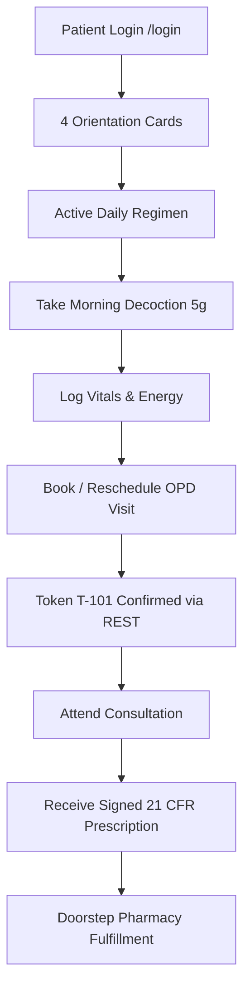

# ZAYVORA Health OS™ — Patient Experience (UX) & Care Journey Report

## Executive Summary
This report details the consumer experience transformation of the **ZAYVORA Patient Portal** (`/patient`). The portal has been re-architected around the core consumer question: **“What do I need to know or do next?”**

By eliminating dense biomedical jargon, adding instant visual orientation, and integrating live RESTful appointment lifecycle management, the portal transforms patient compliance and mitigates clinical anxiety.

---

## 1. The 4 Consumer Orientation Cards
Positioned prominently above the fold, these four cards provide immediate situational awareness:

| Card | Heading | Content Example | Purpose |
| :---: | :--- | :--- | :--- |
| 📍 | **Where am I?** | *ZAYVORA Matab™ Patient Care Portal • Connected to Central Hospital* | Confirms clinical setting, facility identity, and data source. |
| 🩺 | **Health Status** | *Constitutional Mizaj: Phlegmatic (Barid Balghami) • Active Care Plan* | Translates diagnosis into reassuring, actionable wellness context. |
| ⚡ | **Next Step** | *Take morning Majun Suranjan (5g) after breakfast with lukewarm water* | Eliminates hesitation; states the exact next therapeutic action. |
| 🗓️ | **Next Appointment** | *Sept 25, 2026 at 11:30 AM with Prof. (Dr.) Mansoor Alam (Token T-101)* | Displays OPD date, time, clinician name, and OPD queue token. |

---

## 2. Jargon Elimination & Plain-Language Mapping

| Academic / Clinical Label | Consumer Plain-Language Label | Patient Meaning |
| :--- | :--- | :--- |
| *Asbab-e-Sittah Dyscrasia* | **Daily Habits & Lifestyle** | Guidance on sleep, ambient air, physical activity, and emotional balance. |
| *Su-e-Mizaj Barid Balghami* | **Cold & Phlegmatic Imbalance** | Digestively sluggish, joint aches aggravated by cold damp weather. |
| *Murakkabat Posology* | **Medicines & Daily Regimen** | Itemized herbal dosages, timing relative to meals, and vehicle (lukewarm water). |
| *Treatment Orchestration* | **My Care Plan** | 30/60/90-day structured phase progress towards equilibrium. |
| *Patient Encounter Matrix* | **Upcoming Visits & Consultations** | Past and scheduled OPD clinical encounters and tokens. |
| *Synthetic CDS Engine* | **Ask Hakeem Sahab** | Friendly AI health guide providing classical lifestyle recommendations. |

---

## 3. End-to-End Visual Patient Care Journey

---

## 4. Live API & REST Appointment Management
- **Live Records**: Loads directly from `GET /api/v1/patient/my-records` with session tokens.
- **Booking**: Embedded modal submits `POST /api/v1/appointments` with instant token issuance (`T-101`).
- **Rescheduling**: Modal submits `PATCH /api/v1/appointments/{id}` with new slot selection.
- **Cancellation**: One-click prompt submits `DELETE /api/v1/appointments/{id}`.
- **Data Protection**: Transparent badge indicates live encryption under DPDP 2023 and ABDM standards.
