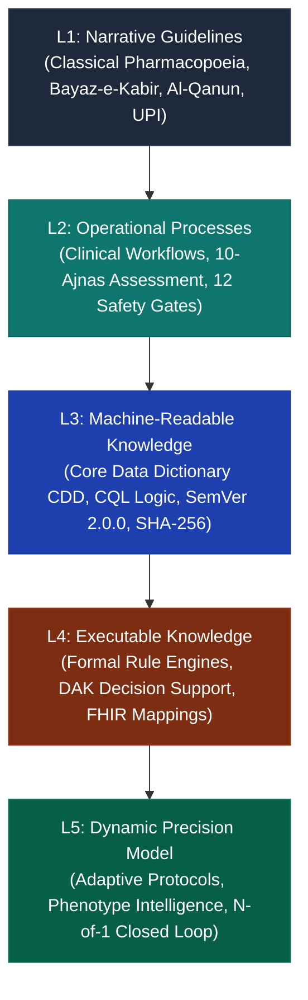

# ZAYVORA Health OS™ — 27-Phase Master Evolution Blueprint
## "From Classical Pharmacopoeia to Adaptive Precision Healthcare OS"
### Aligned with WHO SMART Guidelines (L1–L5) & WHO Learning Health Systems Framework

---

## 1. Executive Doctrine & Strategic Sequencing

The evolution of ZAYVORA Health OS™ follows an inviolable clinical and operational principle:

$$\text{Clinically Trustworthy System} \longrightarrow \text{Learning Health System} \longrightarrow \text{Adaptive Precision OS}$$

```
NOW:
Mufradat + Evidence + Safety + Mizaj + 12-Axis + Hakeem Sahab + Clinician Approval + Nuskha
↳ End-to-End Working Clinical Intelligence Core
THEN:
Outcome Intelligence
THEN:
Pharmacovigilance + RWE
THEN:
Learning Healthcare System
THEN:
ABDM / FHIR + Multi-Clinic Federation
THEN:
Adaptive Precision Healthcare (Phases 17–27)
```

---

## 2. Inviolable Governance Boundary: Autonomous Operations vs. Autonomous Medicine

ZAYVORA Health OS™ draws a strict, non-negotiable architectural boundary:

| Operational Dimension | Automation Level | Human Clinician / Governance Gate |
| :--- | :--- | :--- |
| **Appointment Scheduling & Follow-up Reminders** | Fully Autonomous | System handles queue and calendar optimization |
| **Patient Adherence Monitoring & Notifications** | Fully Autonomous | Automated SMS/WhatsApp/Push posology guidance |
| **Ambient Acoustic Scribing & Draft SOAP Generation** | Autonomous Drafting | **MANDATORY**: Clinician review & lock before EMR save |
| **ICD-11, Unani Amraz & NAMASTE Coding Assistance** | Autonomous Mapping | Clinician accepts or overrides diagnostic codes |
| **Research Cohort De-identification & Assembly** | Fully Autonomous | HIPAA § 164.514(b)(2) irreversible salt-hash |
| **Dispensary FEFO Cross-Clinic Balancing** | Fully Autonomous | Automated stock transfer based on earliest expiry |
| **Safety Alerts & Toxic Lot Quarantine Signals** | Autonomous Trigger | DSMB / Clinical Governance Board emergency review |
| **Clinical Diagnosis** | **NEVER AUTONOMOUS** | **HARD-BLOCK**: Requires licensed Hakeem / MD sign-off |
| **Prescription Ratification & Dispense Authorization** | **NEVER AUTONOMOUS** | **HARD-BLOCK**: Role `AI_COPILOT` cannot ratify nuskhas |
| **Treatment Modification / Dose Escalation** | **NEVER AUTONOMOUS** | **HARD-BLOCK**: Clinician discretion only |
| **Clinical Knowledge Promotion to Production** | **NEVER AUTONOMOUS** | **HARD-BLOCK**: Clinical Governance Board quorum required |

---

## 3. WHO SMART Guidelines 5-Level Architecture

ZAYVORA Health OS™ implements the full World Health Organization SMART Guidelines continuum:



1. **L1 Narrative**: Unani classical monographs and standardized clinical literature (*Al-Qanun fi al-Tibb*, *Bayaz-e-Kabir*, *Qarabadin-e-Azam*, *Unani Pharmacopoeia of India*).
2. **L2 Operational**: Human-readable clinical workflows, 12 organ-axis screening matrices, 8-tier Parhez dietary protocols, and clinician sign-off state machines.
3. **L3 Machine-Readable**: Standardized Core Data Dictionary (CDD), computable Decision Logic DSL, cryptographic SHA-256 integrity verification, and SemVer 2.0.0 governance.
4. **L4 Executable**: Standalone decision support engines, automated safety firewalls, FHIR R4 profile generators, and verifiable unit test suites.
5. **L5 Dynamic Precision**: Adaptive protocol engine, patient phenotype sub-stratification, continuous digital biomarker surveillance, and N-of-1 personalized evidence.

---

## 4. Master 27-Phase Evolutionary Roadmap

### Part I: Foundation & Trust (Phases 1–8) — [COMPLETE & CERTIFIED]
- **Phase 1: Mufradat Validation Pipeline**: 250 verified monographs + 25 gold benchmark single drugs.
- **Phase 2: Knowledge Graph (ZKI)**: Neo4j schema with 386 nodes, 1,627 relational edges across Amraz, Mizaj, Musleh, and Badal.
- **Phase 3: Safety Firewall**: 12 deterministic safety gates, Schedule E(1) statutory poison gating, Tadbeer detoxification checks, special population contraindication blocks.
- **Phase 4: Hakeem Sahab Grounded AI**: Domain Bio-BERT embedding, Hybrid RAG with semantic retrieval, citation grounding.
- **Phase 5: 12 Organ-Axis Intelligence**: Multi-axis radar scoring, physiological biomarker cross-talk, sub-clinical dyscrasia detection.
- **Phase 6: Murakkab Intelligence**: 50 classical compound formulations, ingredient role governance (*Juz-e-Azam*, *Muawin*, *Musleh*), thermal clash audit.
- **Phase 7: Nuskha Nawisi Architecture**: 7 pillars of canonical prescribing, Badal-e-Advia substitution, Munzij-Mushil phase-appropriate sequencing.
- **Phase 8: Patient 360 Clinical Workflow**: Ambient acoustic scribing (Urdu/Roman Urdu/English), longitudinal SOAP notes, 10-Ajnas quantitative Mizaj assessment.

### Part II: Pharmacy, Outcomes & Interoperability (Phases 9–16) — [COMPLETE & CERTIFIED]
- **Phase 9: Pharmacy & Electronic Batch Manufacturing (eBMR)**: Digital prescription dispensing, FEFO batch selection, 21 CFR Part 11 cryptographic signatures.
- **Phase 10: Outcome Intelligence ("What Changed?")**: 4-tier classical response classification (*Kamil*, *Juz'i*, *Ghair Mu'athir*, *Intikas*), longitudinal VAS delta, biomarker delta tracking.
- **Phase 11: Pharmacovigilance (ICH E2B)**: Adverse Drug Reaction (ADR) intake, Naranjo algorithm causality assessment, dechallenge/rechallenge analysis.
- **Phase 12: Research / RWE Engine**: Decentralized clinical trial cohort builder, protocol adherence analytics, real-world evidence registries.
- **Phase 13: Learning Healthcare System (LHS)**: WHO SMART Guidelines Level 3 DAK, HIPAA § 164.514(b)(2) de-identification, Candidate Knowledge Updates (CKUs).
- **Phase 14: ABDM / FHIR R4 Interoperability**: NRCeS `OPConsultRecord` and `PrescriptionRecord` bundles, dual ICD-11 & Unani Amraz codings, ABDM Milestone 3 encrypted HIP envelopes.
- **Phase 15: Enterprise Multi-Clinic Federation**: 3-tier clinic hierarchy (`TIER_1_CENTRAL_HOSPITAL`, `TIER_2_REGIONAL_SPECIALTY`, `TIER_3_COMMUNITY_MATAB`), HMAC-signed referrals (`ZAY-REF-...`), cross-facility FEFO inventory balancing.
- **Phase 16: Population Health & Surveillance**: Canonical *Asbab-e-Sittah* 4-season surveillance (*Bahar*, *Saif*, *Khazan*, *Shita*), cohort humoral distribution, multi-clinic pharmacovigilance cluster safety holds.

### Part III: Adaptive Precision Healthcare OS (Phases 17–27) — [CURRENT EVOLUTION]
- **Phase 17: Adaptive Precision Healthcare OS**:
  - True closed-loop learning: $\text{Learn} \to \text{Validate} \to \text{Personalize} \to \text{Treat} \to \text{Measure} \to \text{Learn again}$.
- **Phase 18: Precision Patient Model & Phenotype Intelligence**:
  - Longitudinal patient state tracking *what was tried $\to$ what changed $\to$ what did not change $\to$ what caused adverse effects $\to$ what worked for which phenotype*.
  - Clinical sub-phenotyping (e.g. *Waja-ul-Mafasil* phlegmatic, bilious, melancholic, or sanguine phenotypes).
- **Phase 19: Response Intelligence Engine**:
  - 5-tier response classification: `RESPONDER`, `PARTIAL_RESPONDER`, `NON_RESPONDER`, `INTOLERANT`, `ADHERENT_NON_RESPONDER`.
  - Protocol review triggering for adherent non-responders.
- **Phase 20: Digital Biomarker & Continuous Monitoring OS**:
  - Multi-stream sensor ingestion: Wearables (HRV, sleep, steps), at-home vitals, symptom diaries, and PROMs.
  - Early risk signal detection with clinician alert routing.
- **Phase 21: N-of-1 / Personalized Evidence Engine**:
  - Individualized treatment response trajectories tracking within-patient variability.
  - "What appears to work for this specific constitutional phenotype?"
- **Phase 22: Clinical Trial / Research OS**:
  - Automated trial cohort assembly, randomized arm management, blinding controls, and DSMB safety export.
- **Phase 23: Federated Multi-Clinic Learning**:
  - Privacy-preserving learning across distributed clinics without centralized pooling of raw patient data.
- **Phase 24: ZAYVORA Knowledge Compiler**:
  - Formal Executable Rule schema: `Rule ID`, `Version`, `Source Evidence`, `Inputs`, `Logic`, `Outputs`, `Contraindications`, `Reviewer Approval`, `Review Date`, `Test Cases`.
- **Phase 25: Clinical Simulation & Digital Twin Layer**:
  - In silico treatment trajectory simulation. Inviolable rule: $\text{Prediction} \ne \text{Diagnosis}$ and $\text{Simulation} \ne \text{Treatment Authority}$.
- **Phase 26: Global Clinical Knowledge Localization**:
  - Jurisdiction-specific regulatory and formulary adapters (India AYUSH, UAE MOHAP, UK MHRA, Africa, Southeast Asia).
- **Phase 27: Population Learning Network**:
  - Macro-level virtuous cycle: Care data $\to$ Outcomes $\to$ Evidence $\to$ Validated Knowledge $\to$ Improved Population Care.

---

## 5. Architectural Invariant Summary

1. **Deterministic Safety Primacy**: Under no condition shall an autonomous agent override statutory poison limits or schedule E(1) purification requirements.
2. **Strict Cryptographic Lineage**: All referral tokens, eBMR release records, and DAK decision rules must carry verifiable HMAC/SHA-256 signatures.
3. **Zero Knowledge Contamination**: Real-world evidence cannot alter clinical prescribing rules without human Clinical Governance Board quorum ratification.
