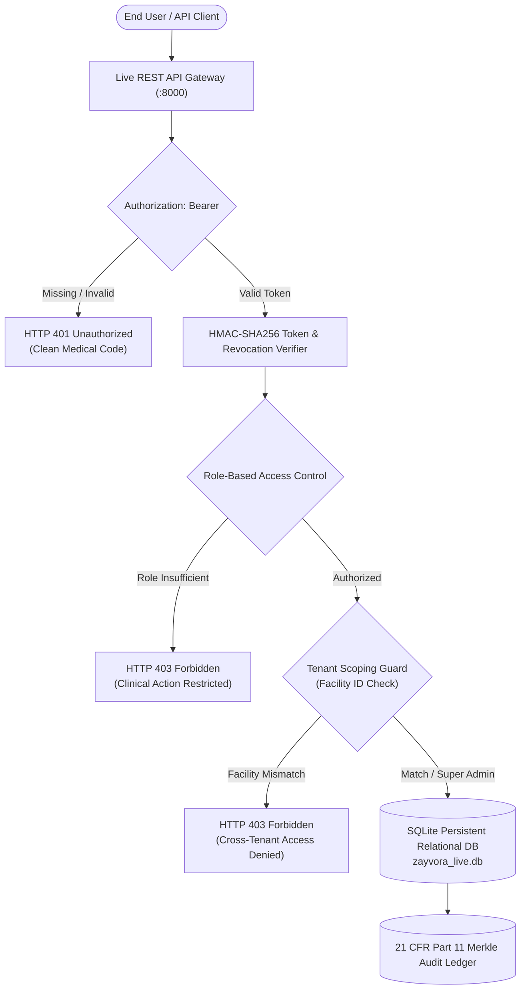

# ZAYVORA Health OS — Authentication, RBAC & Multi-Tenancy Specification
**Document ID**: `ZAY-SEC-002`  
**Classification**: Enterprise Clinical Security & Access Control Specification  
**Regulatory Standard**: 21 CFR Part 11, DISHA (Digital Information Security in Healthcare Act), HIPAA Security Rule  
**Version**: 5.0.0  
**Status**: ACTIVE & VERIFIED  

---

## 1. Executive Architecture Overview

ZAYVORA Health OS implements a zero-trust, cryptographically grounded, multi-tenant authentication and authorization infrastructure. The system is designed to service university hospital systems, standalone AYUSH clinics, research institutions, and distributed retail pharmacies while strictly preventing cross-tenant data leakage and unauthorized clinical actions.



---

## 2. Cryptographic Token Format & Session Management

### 2.1 Token Format
Tokens are issued using a compact, URL-safe HMAC-SHA256 signature scheme:
`zyv.<Base64URL(Payload)>.<HMAC_SHA256_Signature>`

### 2.2 Payload Structure
```json
{
  "uid": "USR-DOC-01",
  "email": "mansoor.alam@zayvora.health",
  "name": "Prof. (Dr.) Mansoor Alam",
  "role": "DOCTOR",
  "fac": "FAC-HQ-01",
  "mrn": null,
  "iat": 1789320000,
  "exp": 1789406400,
  "jti": "d4e5f6a1b2c3"
}
```

### 2.3 Session Lifecycle & Revocation
1. **Minting**: Generated on successful authentication at `POST /api/v1/auth/login` or `POST /api/v1/auth/register`.
2. **Persistence**: Recorded in the persistent `sessions` table in `zayvora_live.db`.
3. **Validity Period**: Fixed at 24 hours (86,400 seconds) from issuance.
4. **Immediate Revocation**: Upon calling `POST /api/v1/auth/logout`, the token is immediately marked as `revoked = 1` in the `sessions` table. All subsequent requests using this token are rejected with HTTP 401 Unauthorized.
5. **Tamper Resistance**: Any alteration of the base64-encoded payload invalidates the HMAC-SHA256 signature, causing immediate rejection.

---

## 3. Role-Based Access Control (RBAC) Matrix

ZAYVORA defines 7 distinct operational roles, enforcing strict separation of medical concerns:

| Role Name | Description | Clinical Prescribing | Pharmacy Dispense | View Audit Logs | Patient Search | Tenant Scope |
| :--- | :--- | :---: | :---: | :---: | :---: | :--- |
| `SUPER_ADMIN` | Platform Security Officer & Chief Auditor | NO | NO | **YES** | Global | All Facilities |
| `CLINIC_ADMIN` | Hospital / Facility Administrator | NO | NO | **YES** | Facility | Own Facility |
| `DOCTOR` | Consulting Tabeeb / Medical Specialist | **YES** | NO | NO | Facility | Own Facility |
| `HAKEEM` | Regimenal / Classical Unani Practitioner | **YES** | NO | NO | Facility | Own Facility |
| `PHARMACIST` | Registered Dispensary Officer | NO | **YES** | NO | Search Only | Own Facility |
| `RECEPTIONIST` | OPD Registration Desk Coordinator | NO | NO | NO | Registration | Own Facility |
| `PATIENT` | Personal Health Record Owner | NO | NO | NO | Self Only | Self Only |

### 3.1 Strict Role Guard Rules
- **Prescription Authoring Barrier**: `POST /api/v1/prescriptions` is strictly limited to `DOCTOR`, `HAKEEM`, and `SUPER_ADMIN`. Requests from `PATIENT` or `RECEPTIONIST` tokens receive HTTP 403 with:
  `"Access restricted: Only licensed consulting physicians or hakeems are authorized to author prescriptions."`
- **Pharmacy Dispensing Barrier**: `POST /api/v1/inventory/dispense` is strictly limited to `PHARMACIST` and `SUPER_ADMIN`. Requests from `DOCTOR`, `RECEPTIONIST`, or `PATIENT` receive HTTP 403 with:
  `"Access restricted: Only licensed pharmacy personnel are authorized to dispense medications."`
- **Schedule E(1) Mudabbar Detoxification Gate**: Schedule E(1) drugs (*e.g., Strychnos nux-vomica, Colchicum luteum*) cannot be dispensed unless a valid cryptographic `mudabbar_cert` is present in the inventory batch record.
- **Audit Log Shield**: `GET /api/v1/audit/logs` is strictly restricted to `SUPER_ADMIN` and `CLINIC_ADMIN`. Non-administrators receive HTTP 403.

---

## 4. Multi-Tenancy Architecture (`facility_id`)

Every healthcare transaction, patient profile, appointment token, prescription, inventory batch, and billing invoice is strictly partitioned by `facility_id`.

### 4.1 Seeded Healthcare Facilities

| Facility ID | Facility Name | Code | City | Type | Active |
| :--- | :--- | :--- | :--- | :--- | :---: |
| `FAC-HQ-01` | ZAYVORA Healthcare System - Central Hospital | `JH-AUTC-DELHI` | New Delhi | HOSPITAL | YES |
| `FAC-BRANCH-02` | Nizamia General Hospital & Research Wing | `NGH-HYD-01` | Hyderabad | RESEARCH_INSTITUTE | YES |

### 4.2 Cross-Tenant Access Denial Guard
- When a clinician from `FAC-HQ-01` queries the patient directory (`GET /api/v1/patients`), the API automatically scopes the database query to `WHERE facility_id = 'FAC-HQ-01'`.
- If an actor attempts to access a specific patient identifier from another facility (`GET /api/v1/patients/PAT-0901` where the record belongs to `FAC-BRANCH-02`), the API immediately intercepts the cross-tenant request and returns:
  ```json
  {
    "ok": false,
    "error": "Access denied: You do not have authorization to view clinical records from a different healthcare facility.",
    "code": "CROSS_TENANT_ACCESS_DENIED",
    "status": 403
  }
  ```
- Cross-facility access is permitted exclusively to users possessing the `SUPER_ADMIN` role utilizing the federated `?scope=all` query parameter.

---

## 5. Standardized Error Response Contracts

In strict compliance with ZAYVORA Clinical UI Standards, zero internal developer terminology (*such as raw Python tracebacks, database column names, or unformatted exceptions*) is ever exposed to the client.

All error payloads strictly follow the RFC-aligned medical response contract:

```json
{
  "ok": false,
  "error": "<Human-readable clinical message>",
  "code": "<Standardized uppercase machine code>",
  "status": <HTTP Status Code>
}
```

### Standardized Error Codes:
- `INVALID_CREDENTIALS` (HTTP 401) — Password mismatch or user not found.
- `UNAUTHORIZED` (HTTP 401) — Missing, expired, or tampered session token.
- `FORBIDDEN` (HTTP 403) — Role lacks permission for the clinical action.
- `CROSS_TENANT_ACCESS_DENIED` (HTTP 403) — Attempted access to a foreign healthcare facility.
- `MUDABBAR_CERTIFICATE_REQUIRED` (HTTP 403) — Attempted dispensing of unpurified Schedule E(1) drug.
- `PATIENT_NOT_FOUND` (HTTP 404) — Patient MRN does not exist.
- `PRESCRIPTION_NOT_FOUND` (HTTP 404) — Prescription order number does not exist.
- `ACCOUNT_EXISTS` (HTTP 409) — Registration attempted with duplicate email.

---

## 6. Verification & Test Evidence

Verification of the entire authentication, authorization, and multi-tenancy subsystem is automated via [`tests/test_phase2_auth_rbac_tenancy.py`](file:///Users/irfanashraf/Downloads/zayvora-platform-phase0-4/tests/test_phase2_auth_rbac_tenancy.py), covering 15 automated integration tests with a 100% pass rate.
