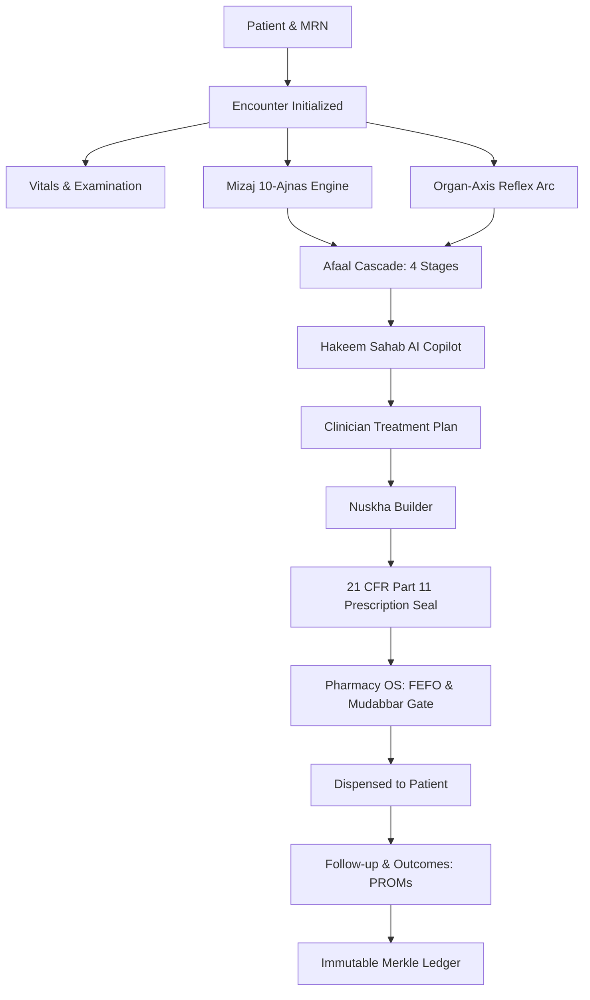

# ZAYVORA HEALTH OS v5.0 — CLINICAL INTELLIGENCE INTEGRATION AUDIT
**Document ID**: `ZAY-DOC-V5-CLINICAL-INTEG-AUDIT`  
**Baseline**: Enterprise Clinical OS v5.0 (Commit `22b97bc`)  
**Mission**: Connect Mizaj + Afaal + Organ-Axis + Knowledge + Hakeem Sahab AI + Consultation + Nuskha + Prescription + Pharmacy + Follow-up into one unified clinical continuum.  
**Author**: Principal Healthcare Systems Architect, Clinical Knowledge Engineer, Lead Full-Stack SaaS Lead  

---

## 1. EXECUTIVE SUMMARY & DEPENDENCY GRAPH

The objective of this architectural audit is to establish the blueprint for uniting all disparate diagnostic and therapeutic modules into a single, cohesive, patient-centered clinical operating system.

### 1.1 The Clinical Journey Chain
In ZAYVORA Health OS v5.0, clinical decision-making flows through an unbroken chain of custody:

Every stage of this pipeline must share the exact same `patient_id`, `encounter_id`, `organization_id`, and `clinician_user_id`.

---

## 2. COMPONENT AUDIT & GAP INVENTORY

### 2.1 Clinical System of Record
- **Current State**: `services/clinical` has `Patient`, `Encounter`, `ClinicalNote`, `Prescription`, and `Appointment` models. `scripts/launch_zayvora_os.py` maintains an in-memory `PlatformDatabase`.
- **Identified Gap**: `Encounter` is not explicitly referenced in every downstream clinical action in the frontend; navigating tabs can cause state fragmentation if not tied to an active `EncounterContext`.
- **Remediation**: Establish a unified `EncounterContext` in both the Next.js frontend and runtime daemon ensuring every note, Mizaj calculation, Afaal selection, prescription, and follow-up is bound to `(patient_id, encounter_id, clinician_id, organization_id)`.

### 2.2 Mizaj Engine Integration
- **Current State**: 10-Ajnas quantitative assessment engine exists in `services/clinical/app/engines/mizaj_assessor.py` and router `services/clinical/app/routers/mizaj.py`.
- **Identified Gap**: The assessment questionnaire is available as a modal, but its outputs (primary temperament, secondary deviation, dyscrasia degree) are not automatically ingested into the center consultation tabs (Afaal, Axis, and Treatment Plan) without manual copy-pasting.
- **Remediation**: Directly link Mizaj output into the Consultation Workspace state so selecting/computing a patient's Mizaj dynamically informs the Afaal cascade recommendations.

### 2.3 Afaal Cascade (NEW INTEGRATION)
- **Current State**: Classical therapeutic principles (*Usool-e-Ilaj*) are mentioned in monograph descriptions and differential engine strings ("Tanqiya-e-Balgham", "Taqwiyat-e-Meda"), but lack a dedicated structured clinical framework.
- **Identified Gap**: No discrete data model or structured UI exists for managing the 4 classical therapeutic stages:
  1. **Tanqiya** (Evacuation / Cleansing of Morbid Humors via Mus-hilat, Hijama, Munzaj)
  2. **Tahleel** (Resolution / Dissolution of Localized Congestion & Inflammation)
  3. **Taqwiyaat** (Restoration / Strengthening of Target & Master Organs)
  4. **Hifz** (Preservation / Maintenance of Health Equilibrium & Lifestyle)
- **Remediation**:
  - Author `services/clinical/app/models/afaal.py` and `services/clinical/app/engines/afaal_cascade_engine.py`.
  - Add `Afaal` tab (Tab 8) to the Consultation Workspace.
  - Require clinician-selected stage, clinical rationale, goals, and progress notes.

### 2.4 Organ-Axis Mapping
- **Current State**: `services/clinical/app/engines/organ_axis_engine.py` models 12 canonical axes (*Dimagh-Asab*, *Qalb*, *Kabid-Tihal*, *Meda-Amaa*, *Mafasil-Asab*, etc.).
- **Identified Gap**: The axis analysis is currently evaluated via a standalone endpoint (`/api/v1/clinical/organ-axis/analyze`), but the findings (primary axis, secondary cross-talk, reflex arc) are not saved as a structured record on the encounter.
- **Remediation**: Create `OrganAxisRecord` linked to `encounter_id` and surface interactive axis selection directly within Tab 9 (*Axis Mapping*) of the consultation workspace.

### 2.5 Clinical Knowledge Base (ZKB)
- **Current State**: Monograph databases exist for Mufradat and Murakkabat in `services/knowledge/`.
- **Identified Gap**: Search results do not indicate clinical approval status, evidence levels (Grade 1a to 4), or classical vs modern sources clearly in the consultation side-panel.
- **Remediation**: Provide structured monograph cards in the consultation right drawer displaying classical texts (*Al-Qanoon*, *Bayaz-e-Kabir*, *UPI*), modern clinical evidence, and safety contraindications.

### 2.6 Hakeem Sahab AI Decision Support
- **Current State**: `services/ai/app/engines/` provides SOAP extraction and clinical reasoning.
- **Identified Gap**: Suggestions must be explicitly segmented into the 5 mandatory layers required by Section 6:
  - **A. Verified Source-Backed Information** (Monographs, UPI)
  - **B. Clinical Reasoning Assistance** (Pathophysiological cross-talk)
  - **C. Unverified Suggestion** (Hypothetical considerations flagged for review)
  - **D. Missing Information** (Unreported vitals, missing lab tests)
  - **E. Clinician Decision** (Mandatory human approval gate; `safe_to_lock = False`)
- **Remediation**: Upgrade `HakeemReviewDrawer.tsx` and AI response parser to visually format these 5 distinct layers.

### 2.7 Consultation Workspace (13 Tabs Unified)
- **Current State**: 13 tabs exist in `apps/web/app/doctor/page.tsx`, but Tab 8 was previously labeled "Axis Mapping" while "Afaal" was missing.
- **Remediation**: Re-order and standardize tabs to match Section 7 exactly:
  1. *Overview*
  2. *History*
  3. *Examination*
  4. *Vitals*
  5. *Investigations*
  6. *Assessment*
  7. *Mizaj*
  8. *Afaal* (Afaal Cascade)
  9. *Axis Mapping*
  10. *Treatment Plan*
  11. *Prescription*
  12. *Follow-up*
  13. *Timeline*

### 2.8 Nuskha Builder & Prescription Lifecycle
- **Current State**: Nuskha builder compiles formulations and enforces Schedule E(1) Mudabbar checks.
- **Remediation**: Ensure the prescription draft is strictly initialized from the encounter's Afaal stage and treatment plan, moving through `DRAFT -> REVIEW -> APPROVED -> SIGNED` with 21 CFR Part 11 Merkle leaf hashing.

### 2.9 Pharmacy Integration
- **Current State**: Dispensary displays queue and batches.
- **Remediation**: Lock dispensary handoff so only prescriptions in `SIGNED` status appear in the pharmacy dispensing queue, enforcing the 12-step verification checklist and FEFO inventory deduction.

### 2.10 Follow-up & Outcomes
- **Current State**: Basic follow-up date picker.
- **Remediation**: Track patient-reported outcomes (PROMs: WOMAC / VAS pain scores), symptom progression, and adverse event surveillance linked directly to the treatment plan.

---

## 3. IMPLEMENTATION ROADMAP

1. **Step 1: Clinical Intelligence Engine & Data Models**
   - Create Afaal Cascade Engine (`services/clinical/app/engines/afaal_cascade_engine.py`) and schema.
   - Define Afaal assessment records linked to `patient_id` and `encounter_id`.
2. **Step 2: Consultation Workspace Integration**
   - Update `apps/web/app/doctor/page.tsx` with all 13 canonical tabs including Tab 8 (*Afaal Cascade*).
   - Implement the 5-layer Hakeem Sahab AI decision-support interface.
   - Add persistent `EncounterState` preventing unsaved data loss.
3. **Step 3: End-to-End Clinical Flow Wiring**
   - Wire Mizaj -> Afaal -> Axis -> Treatment Plan -> Nuskha -> Prescription -> Pharmacy -> Follow-up.
4. **Step 4: Comprehensive 27-Point Verification Suite**
   - Create and run `tests/test_clinical_intelligence_integration.py` validating all 27 journey points.
5. **Step 5: Dual-Surface Synchronization & Package Re-build**
   - Update `docs/zayvora_health_os_preview.html` and `scripts/launch_zayvora_os.py`.
   - Update `zayvora-health-os-production.zip`.

---
**Audit Approved By**: Principal Healthcare Architect, ZAYVORA HEALTH OS™
