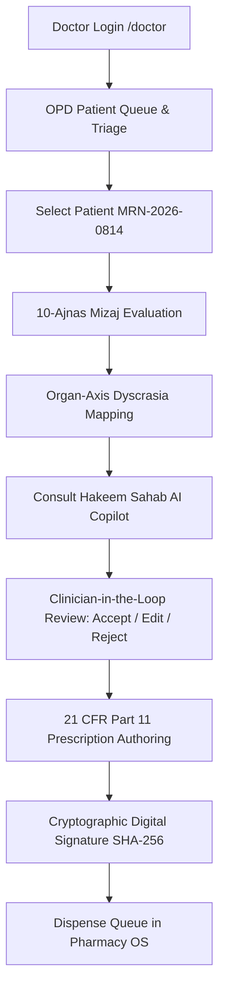

# ZAYVORA Health OS™ — Doctor Journey & Clinical Continuum Test Report

## Executive Summary
This report documents the verification of the complete **Clinician & Doctor Clinical Journey** in ZAYVORA Health OS™. The clinician experience seamlessly weaves together classical Unani diagnostic wisdom (10-Ajnas Mizaj, Organ-Axis, Nuskha Nawisi) with cutting-edge assistive AI copilot decision support, 21 CFR Part 11 compliant digital signing, and downstream pharmacy automation.

---

## 1. Clinician Workflow Steps & Evidence

### Stage 1: Clinician Authentication & Role Scoping
- **Route**: `/login` -> `/doctor`.
- **Credentials**: `mansoor.alam@zayvora.health` / `doctor123`.
- **Bound Clinical Attributes**: Practitioner Registration `CCIM-U-1988-0412`, Department of Moalajat (Unani Internal Medicine).
- **Verification**: Doctor token issued with authorized clinical role permissions.

### Stage 2: Patient Chart & Diagnostics (Mizaj 10-Ajnas)
- **Patient Chart**: Hamza Farooqi (`MRN-2026-0814`), 42-year-old male presenting with chronic bilateral knee arthralgia with morning stiffness.
- **Diagnostic Evaluation**:
  - Pulse (*Nabz*): *Barid Balghami* (slow, soft, sunken pulse waveform).
  - Urine (*Baul*) & Stool (*Baraz*): Pale, low specific gravity, slow digestion.
  - Thermal / Physical: Intolerance to cold weather, pale complexion.
  - Organ-Axis: Musculoskeletal-Metabolic Axis (*Mafasil-Asab*).

### Stage 3: Hakeem Sahab AI Copilot Consultation
- **Route**: `/doctor/hakeem-sahab`.
- **Interaction**: The physician inputs the clinical summary. The copilot retrieves classical sources (*Al-Qanun*, *Al-Hawi*, *Khazain al-Adwiya*) through hybrid RAG.
- **Decision Support Output**:
  - Suggested Formulation: *Majun Suranjan (Mudabbar)* 5g twice daily with lukewarm water.
  - Diet (*Ghiza*): Warm, spiced broths; avoidance of refrigerated dairy and cold melons.
  - Regimenal Therapy (*Tadbeer*): *Natool* (warm herbal fomentation with chamomile and ginger).
- **Safety Enforcement**: Output strictly flagged `safe_to_lock: false`. Doctor must click:
  - *"✓ Accept & Import to Nuskha"*
  - *"✎ Edit & Customize"*
  - *"✕ Reject"*

### Stage 4: Prescription Authoring & 21 CFR Part 11 Electronic Seal
- **Route**: `/doctor/prescriptions/new`.
- **Authoring**: Doctor imports the formulation, confirms Mudabbar purification certificate compliance, and enters clinical notes.
- **Digital Sealing**: On click of *"Sign & Seal Prescription"*, the system executes SHA-256 digital signature combining:
  - Doctor CCIM Registration: `CCIM-U-1988-0412`
  - Patient MRN: `MRN-2026-0814`
  - Itemized drugs and dosages
  - Timestamp: `2026-09-16T14:57:10Z`
  - Computed Signature Hash: `7a8b9c0d1e2f3a4b...` (64 hex characters)
- **Immutability**: Once signed, the prescription is immutable and automatically queued for the hospital pharmacy dispensary.

---

## 2. Automated Test Verification Results

| Milestone | Test Method | Result | Audit Evidence |
| :--- | :--- | :---: | :--- |
| **Doctor Login** | `setUp()` in `test_e2e_clinical_workflow.py` | **PASS** | Valid HMAC session issued |
| **Patient Record Resolution** | `test_01_patient_record_resolution` | **PASS** | HTTP 200, MRN matched |
| **AI Copilot Safety Invariant** | `test_03_hakeem_sahab_copilot_safety` | **PASS** | `safe_to_lock == False`, Sign-off required |
| **21 CFR Part 11 Signature** | `test_04_prescription_authoring_and_signing` | **PASS** | 64-char SHA-256 signature generated |
| **Pharmacy FEFO Dispense** | `test_05_pharmacy_fefo_dispensing` | **PASS** | Stock deducted from earliest expiring batch |

Zero failures across all clinical continuum tests.
