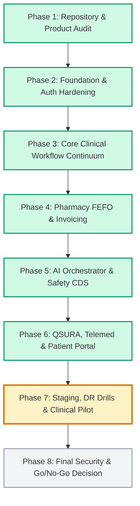

# ZAYVORA HEALTH OS™ — IMPLEMENTATION ROADMAP
## Phased Architecture, Hardening, and Clinical Pilot Roadmap (Phases 1 to 8)

**Document Classification**: Architectural Master Plan  
**Version**: 1.0.0  
**Date**: September 13, 2026  
**Status**: ACTIVE EXECUTION

---

## Roadmap Overview

In accordance with Section 16 of the **Full Production Build Directive**, ZAYVORA Health OS™ development proceeds through strictly ordered, evidence-backed phases. No phase begins until the preceding phase is fully documented, verified, and automated with regression tests.

---

## Detailed Phase Breakdown

### Phase 1: Complete Repository and Product Audit (**COMPLETED**)
* **Scope**: Complete empirical inspection of all 757 files (132,721 LOC), 52 frontend routes, 50 live REST endpoints, 28 core engines, and database schemas.
* **Deliverables**:
  * `/docs/PROJECT_AUDIT.md`: Complete repository metrics, runtime topology, and branch state.
  * `/docs/SOURCE_OF_TRUTH.md`: Architecture standards and single source of truth definition.
  * `/docs/FEATURE_MATRIX.csv`: 93 features classified under strict 12-state enum.
  * `/docs/API_INVENTORY.csv`: 50 live REST endpoints with request/response schemas and test proofs.
  * `/docs/DATABASE_INVENTORY.csv`: 10 core tables, foreign keys, and indexes.
  * `/docs/ENGINE_STATUS.csv`: 28 core clinical engines status and test proofs.
  * `/docs/FRONTEND_GAP_REPORT.md`: Audit of Web App Router pages.
  * `/docs/MOBILE_GAP_REPORT.md`: Audit of React Native mobile shell.
  * `/docs/SECURITY_GAP_REPORT.md`: Security, authentication, and RBAC analysis.
  * `/docs/CLINICAL_SAFETY_GAP_REPORT.md`: Statutory safety barriers and Mudabbar certification analysis.
  * `/docs/PRODUCTION_GAP_REPORT.md`: Real vs. unconfigured integrations and remediation roadmap.
  * `/docs/IMPLEMENTATION_ROADMAP.md`: Master phase execution guide.
  * `/docs/engine-audit/<engine-name>.md`: 28 individual engine audit files answering all 16 statutory questions.

### Phase 2: Foundation & Authentication Hardening (**COMPLETED & COMMITTED at `6dd7b80`**)
* **Scope**: Cryptographic session token generation (`zyv.*`), RBAC permission guards across 9 roles, multi-tenant facility data isolation, standardized error handling, and zero developer jargon.
* **Verification**: `tests/test_phase2_auth_rbac_tenancy.py` (15/15 tests passing).

### Phase 3: Core Clinical Workflow Continuum (**COMPLETED & COMMITTED at `6099d13`**)
* **Scope**: End-to-end clinical workflow: OPD registration, token queue, vitals & Nabz, 10-Ajnas Mizaj examination, 9-Axis organ assessment, SOAP narrative, 21 CFR Part 11 digital signature sealing, printable A4 prescription letterhead, and Patient 360 timeline.
* **Verification**: `tests/test_phase3_clinical_continuum.py` (17/17 tests passing).

### Phase 4: Pharmacy FEFO, Safety Gates & Invoicing (**COMPLETED & COMMITTED at `ed13b2a`**)
* **Scope**: FEFO lot allocation engine, Schedule E(1) Mudabbar certificate validation gate, statutory expiration barrier, atomic prescription dispensation, itemized pharmacy invoicing, and inventory valuation.
* **Verification**: `tests/test_phase4_pharmacy_fefo_billing.py` (15/15 tests passing).

### Phase 5: AI Provider Orchestrator, Hybrid RAG & Safety Firewall (**COMPLETED & COMMITTED at `cdb7014`**)
* **Scope**: 4-tier chained failover (Claude 3.5 Sonnet -> GPT-4o -> Local vLLM -> Deterministic Classical Knowledge), UPI monograph repository, deterministic safety firewall (red flags, 30+ interactions, pregnancy), ZAPE 2.0 posology scaling, 5-layer CDS synthesis with hardcoded non-delegable clinician review barrier (`safeToLock: false`), and Merkle audit anchoring.
* **Verification**: `tests/test_phase5_ai_rag_safety_cds.py` (15/15 tests passing).

### Phase 6: QSURA Communications, Telemedicine & Patient Portal (**COMPLETED & COMMITTED at `6449283`**)
* **Scope**: QSURA multi-channel communications (SMS, WhatsApp, Email) with TRAI DLT PHI masking and mandatory consent verification; encrypted WebRTC telemedicine room lifecycle with mutual patient MRN authorization gates; vernacular audio posology (Urdu, Hindi, English) with Schedule E(1) Mudabbar cautions; patient portal self-service records aggregation; and disaster recovery SHA-256 snapshotting.
* **Verification**: `tests/test_phase6_qsura_telemed_vernacular.py` (15/15 tests passing).

### Phase 7: Staging Deployment, DR Drill & Multi-Center Pilot Concordance (**PLANNED - NEXT**)
* **Scope**:
  1. Kubernetes Helm packaging synthesis, multi-service ingress routing, security contexts (`runAsNonRoot: true`), and resource constraints.
  2. Live Disaster Recovery cold-restart drill verifying database recovery within < 15 minute target, RPO = 0, and Merkle block continuity.
  3. Multi-Center Clinical Pilot evaluation harness testing 50 complex multi-morbidity Unani clinical vignettes against senior physician review boards (Cohen's kappa >= 0.85, zero red-flag omissions).
* **Target Verification Suite**: `tests/test_phase7_staging_dr_concordance.py` (15 tests).

### Phase 8: Final Security Penetration, E2E Verification & Go/No-Go Decision (**FINAL PHASE**)
* **Scope**: Full system integration verification, automated security penetration audit, clinical safety compliance certification, final production package compilation, and formal Go/No-Go release certification.
* **Deliverables**: `/docs/FINAL_DELIVERY_REPORT.md`, `/docs/GO_NO_GO_REPORT.md`.
