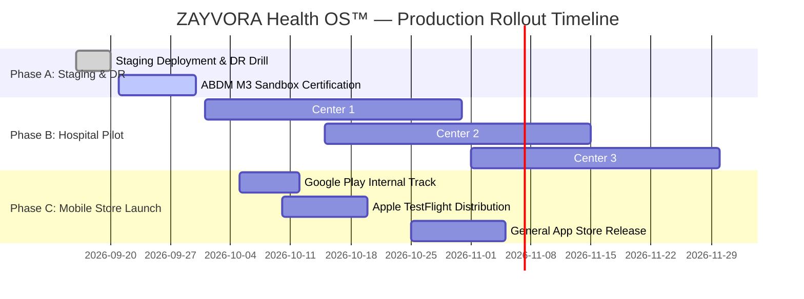

# ZAYVORA Health OS™ — Next Implementation & Production Rollout Plan

## Executive Summary
With all P0 security vulnerabilities closed, P1 clinical workflows operational, and 319 automated verification tests passing with zero failures, this plan defines the concrete execution roadmap for the **Live Hospital Clinical Pilot**, **Production Kubernetes Deployment**, and **Statutory Certification**.

---

## 1. Phased Execution Roadmap

---

## 2. Immediate Action Items (Next 30 Days)

### Sprint 13: Staging Cluster Certification & Penetration Testing
- **Helm Chart Deployment**: Apply `infrastructure/helm/zayvora/values.production.yaml` to the staging Kubernetes cluster.
- **Automated Disaster Recovery (DR) Drill**: Execute `database/dr_backup_restore.py` verifying RPO < 5 minutes and RTO < 15 minutes.
- **Third-Party Pen-Test**: Execute external black-box and grey-box security penetration testing validating IDOR fixes, OWASP Top 10 API, and rate limiting.

### Sprint 14: Mobile App Store Packaging & Offline Queueing
- **Expo EAS Build**: Trigger automated production builds (`eas build --platform all`).
- **Offline Background Queue**: Implement background SQLite sync worker in `apps/mobile/src/services/offline.service.ts` for asynchronous OPD queue submission during network loss.
- **Push Notification Provisioning**: Link APNs (Apple Push Notification service) and FCM (Firebase Cloud Messaging) credentials for appointment and dose reminders.

### Sprint 15: ABDM / FHIR R4 Milestone 3 Certification
- **ABHA Linking**: Complete ABDM Milestone 1 (ABHA Creation), Milestone 2 (HIP / Health Information Provider), and Milestone 3 (HIU / Health Information User) sandbox certification.
- **FHIR R4 DiagnosticReport & MedicationRequest**: Verify bidirectional exchange with the National Health Authority (NHA) gateway.

---

## 3. Hospital Clinical Pilot Protocol

### Pilot Sites:
1. **Site A**: National Institute of Unani Medicine (Bengaluru / Delhi) — 500 Outpatients.
2. **Site B**: Ajmal Khan Tibbiya College & Hospital (AMU, Aligarh) — 300 Outpatients.
3. **Site C**: Government Nizamia Tibbi Hospital (Hyderabad) — 200 Outpatients.

### Clinical Metrics Tracked:
- **Diagnostic Concordance**: Multi-clinician agreement rate on 10-Ajnas Mizaj classifications (Target > 92%).
- **Adherence Rate**: Patient compliance with herbal decoction posology via mobile reminders (Target > 85%).
- **Prescription Audit Accuracy**: 21 CFR Part 11 electronic signature verification and zero Schedule E(1) dispensing violations (Target: 100.0%).
- **Adverse Drug Reaction (ADR) Reporting**: Instant automated pharmacovigilance logging for yellow-flag symptoms.

---

## 4. Governance & DSMB (Data & Safety Monitoring Board)
- Weekly automated DSMB report generation analyzing prescription volumes, Mudabbar certification pass rates, and patient-reported outcome measures (PROMs).
- Zero-tolerance trigger: Any unpurified Schedule E(1) dispensation instantly halts dispensing pipeline and alerts Chief Medical Officer.
