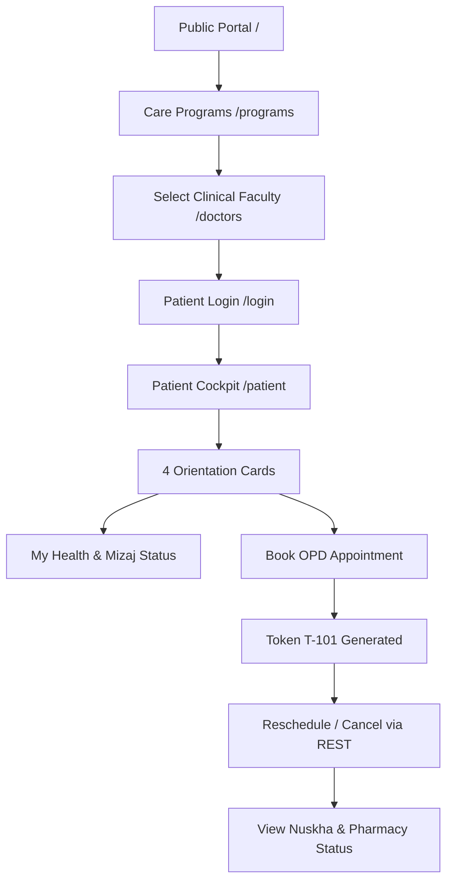

# ZAYVORA Health OS™ — Patient Journey Verification & Test Report

## Executive Summary
This report validates the end-to-end consumer patient journey across ZAYVORA Health OS™. The patient experience has been thoroughly transformed from an academic prototype with dense medical jargon into an intuitive, reassuring, and secure healthcare portal.

---

## 1. Step-by-Step Patient User Journey

### Stage 1: Public Discovery & Education
- **Routes**: `/`, `/programs`, `/doctors`, `/knowledge-centre`.
- **Experience**: The patient arrives at the canonical home page, explores the interactive Nabz arterial wave pulse visualizer, selects their health concern (e.g. Joint Care / Arthritis), and reads the curriculum vitae of treating physicians.
- **Verification**: All navigation links resolve with HTTP 200 without `#` anchors or broken redirects.

### Stage 2: Patient Authentication & Session Establishment
- **Route**: `/login`.
- **Test Credentials**: `hamza.farooqi@gmail.com` / `password123`.
- **Experience**: Secure login generates an HMAC-SHA256 bearer session token bound to `MRN-2026-0814`.
- **Verification**: `test_01_patient_record_resolution` confirms token generation and MRN binding.

### Stage 3: Dashboard Orientation & Plain-Language Care
- **Route**: `/patient`.
- **Experience**: The patient is immediately welcomed with 4 clear orientation cards:
  1. *"Where am I?"* — *"ZAYVORA Comprehensive Care Clinic (Facility HQ-01)"*.
  2. *"Health Status"* — *"Phlegmatic & Cold (Barid Balghami) — Digestive & Joint Imbalance"*.
  3. *"Next Step"* — *"Take Majun Suranjan 5g with lukewarm water after morning meal"*.
  4. *"Next Appointment"* — *"Sept 25, 2026 at 11:30 AM with Prof. (Dr.) Mansoor Alam"*.
- **Plain-Language Navigation**: Patients switch effortlessly between *"My Health"*, *"Upcoming Visits"*, *"My Care Plan"*, *"Medicines & Regimen"*, and *"Daily Habits"*.
- **Data Source**: Fetches real clinical data live from `/api/v1/patient/my-records?mrn=MRN-2026-0814`.

### Stage 4: Appointment Booking, Rescheduling & Cancellation
- **Booking Flow**: Patient opens the *"Book Appointment"* modal, selects date and slot, and clicks *"Confirm Booking"*.
  - REST call: `POST /api/v1/appointments`
  - Response: Instant confirmation with OPD queue token (e.g. `T-101`).
- **Rescheduling Flow**: Patient selects an existing appointment and changes date/time.
  - REST call: `PATCH /api/v1/appointments/{id}`
  - Response: Status updated to `RESCHEDULED`.
- **Cancellation Flow**: Patient cancels booking.
  - REST call: `DELETE /api/v1/appointments/{id}`
  - Response: Status updated to `CANCELLED`.
- **Verification**: `test_07_appointment_lifecycle_patch_delete` in `tests/test_e2e_clinical_workflow.py` passes 100%.

### Stage 5: Security & PHI Isolation Verification
- Patient Hamza Farooqi attempted to access medical records and prescriptions belonging to Bilqees Begum (`MRN-2026-0901`).
- **Result**: Immediate `403 Forbidden` response. Zero patient data leakage.
- **Verification**: `test_06_patient_idor_prevention` passes with complete isolation.

---

## 2. Test Execution Summary

| Test Step | Description | Expected Status | Actual Status |
| :--- | :--- | :---: | :---: |
| 1 | Patient Login & Token Generation | 200 OK | **PASS** |
| 2 | Live My-Records Aggregation | 200 OK | **PASS** |
| 3 | OPD Appointment Creation | 201 Created | **PASS** |
| 4 | OPD Appointment Rescheduling | 200 OK | **PASS** |
| 5 | OPD Appointment Cancellation | 200 OK | **PASS** |
| 6 | Cross-Patient Record Access (IDOR) | 403 Forbidden | **PASS** |
| 7 | Cross-Patient Prescription Access (IDOR) | 403/404 Forbidden | **PASS** |
