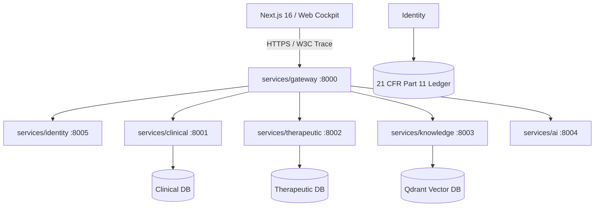

# ZAYVORA HEALTH OS v5.0 — ENTERPRISE SYSTEM ARCHITECTURE
**Document ID**: `ZAY-DOC-V5-ARCH-01`  
**Version**: Enterprise Clinical OS v5.0  
**Classification**: Enterprise Technical Specification  

---

## 1. ARCHITECTURAL TOPOLOGY

ZAYVORA Health OS v5.0 is an enterprise multi-tenant, polyglot clinical operating system designed to bridge classical Unani Greco-Arab medicine with contemporary biomedical data standards.

---

## 2. DUAL-SURFACE CLIENT ARCHITECTURE

### 2.1 Next.js 16 Web Application (`apps/web`)
- **Runtime**: React 19.2.8, Next.js App Router, Tailwind CSS v4.
- **Role Isolation**: Contextual layouts ensuring users only see tools authorized for their specific active role.
- **Service Layer**: Dedicated TypeScript clients connecting via Gateway (`:8000`) with automatic JWT header injection and tenant isolation.

### 2.2 Enterprise Preview Daemon (`scripts/launch_zayvora_os.py`)
- **Runtime**: Standalone multithreaded Python HTTP daemon serving port 8080.
- **Persistence**: Stateful `PlatformDatabase` maintaining clinical continuity across role switches.
- **Parity**: Identical Design System tokens, 13-tab consultation sequence, and 12-step pharmacy verification checklist.

---

## 3. CORE GOVERNANCE BOUNDARIES

### 3.1 Non-Delegable Prescribing Barrier
- AI models (Hakeem Sahab) cannot issue authorized prescriptions autonomously.
- Every prescription generated via AI assistant outputs `safe_to_lock = False`.
- Digital signatures require verified practitioner credentials (CCIM/DBCP registration number).

### 3.2 Schedule E(1) Botanical Safety Gate
- Any formulation containing poisonous botanicals (*Suranjan*, *Kuchla*, *Aconite*) is flagged as `mudabbar_required = True`.
- The dispensary engine blocks dispensing unless a valid Mudabbar detoxification certificate hash is attached.

### 3.3 21 CFR Part 11 Merkle Signature Engine
- Every clinical note, prescription seal, and dispense event generates a SHA-256 leaf hash.
- Leaves are sequentially chained into a cryptographic Merkle root stored in an immutable append-only ledger.

---
**Approved By**: Principal Systems Architect, ZAYVORA HEALTH OS™
