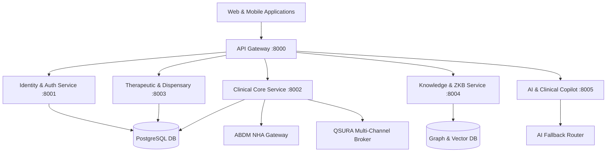

# ZAYVORA Health OS™ — System Architecture Specification

## 1. High-Level Architecture
ZAYVORA Health OS™ is designed as a distributed, event-driven microservices architecture optimized for healthcare data governance, high availability, and statutory compliance.

## 2. Microservice Topology
- **Gateway Service (`services/gateway`):** Reverse proxy, SSL termination, rate limiting, and CORS enforcement.
- **Identity Service (`services/identity`):** Multi-tenant organization isolation, OAuth2 / JWT authentication, RBAC authorization.
- **Clinical Service (`services/clinical`):** Patient 360, clinical encounters, ambient acoustic scribing, 10-Ajnas Mizaj engine, organ-axis analysis, and Merkle audit ledger.
- **Therapeutic Service (`services/therapeutic`):** Nuskha Nawisi compiler, Deterministic Safety Firewall, Tadbeer guardrails, FEFO dispensary allocator, and eBMR manufacturing records.
- **Knowledge Service (`services/knowledge`):** UPI canonical pharmacopoeia, multi-hop ontology knowledge graph, hybrid BM25 / vector RAG, and Clinical Governance Quorum Board.
- **AI Service (`services/ai`):** Hakeem Sahab™ copilot, ZAPE 2.0 posology personalization, response structure validator, and multi-provider runtime fallback.
