# ZAYVORA HEALTH™ — Master Automation & Workflow Flow Map
**Classification:** Enterprise Forensic Automation Architecture  
**System Baseline:** Commit `6d37cd7` | Phase 0–10 Consolidated Repository  
**Audit Standard:** GAMP 5 / 21 CFR Part 11 / ISO 27001 / IEC 62304 / DISHA / AYUSH Schedule T  
**Date:** September 12, 2026  
**Auditor:** Autonomous Systems & Clinical Automation Auditing Desk  

---

## Executive Overview

This document provides architectural sequence, state, and pipeline flowcharts for all operational automation systems in ZAYVORA HEALTH™. Every diagram illustrates the exact lifecycle:  
$$\text{Trigger} \longrightarrow \text{Authentication / Gate} \longrightarrow \text{Execution Broker} \longrightarrow \text{Database / State Mutation} \longrightarrow \text{External API / Transport} \longrightarrow \text{Failure / Retry Path}$$

---

## 1. Multi-Tenant Asynchronous Task Queue & Worker Daemon Architecture

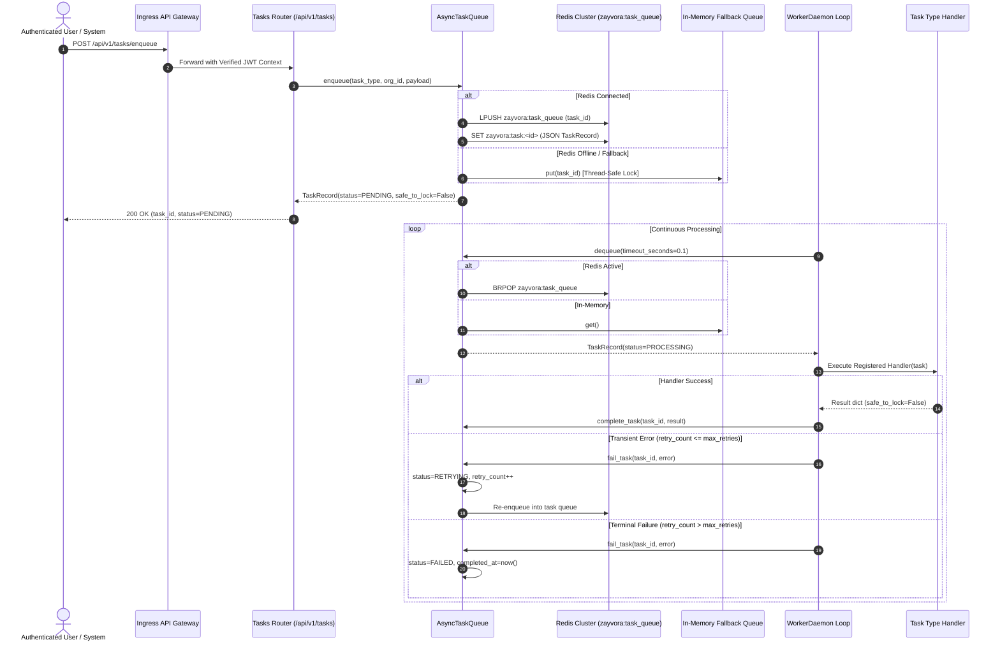

---

## 2. ABDM Milestone 3 Inbound Webhook, Packet Reconciliation & Dual-Coding Workflow

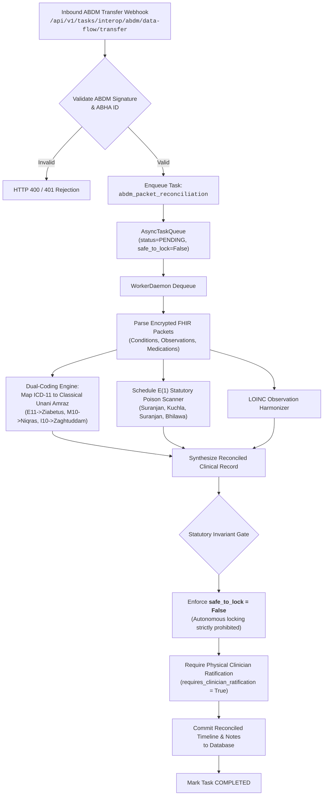

---

## 3. Continuous Wearable Telemetry Webhook Ingestion & Humoral Drift Workflow

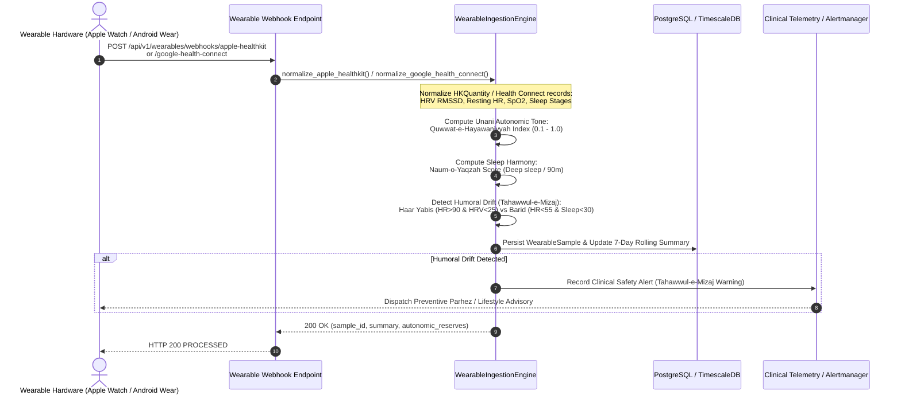

---

## 4. QSURA Multi-Channel Clinical Communication Pipeline

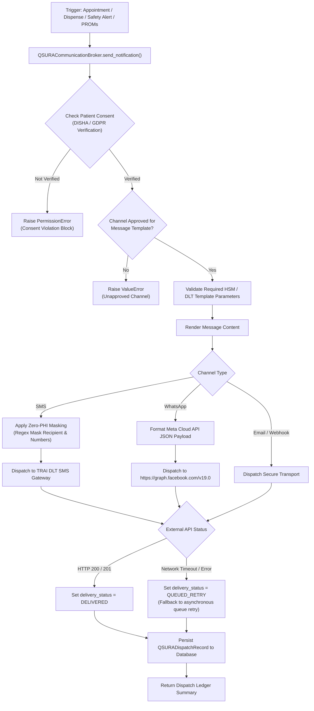

---

## 5. Dispensary FEFO Automated Inventory Allocation & Mudabbar Safety Gate

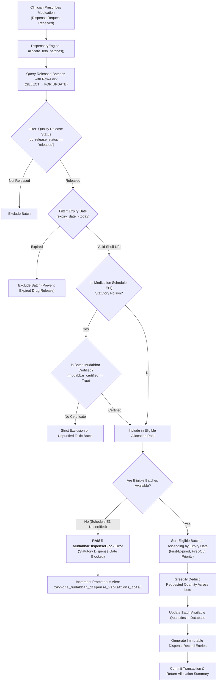

---

## 6. Manufacturing OS Electronic Batch Manufacturing Record (eBMR) Workflow

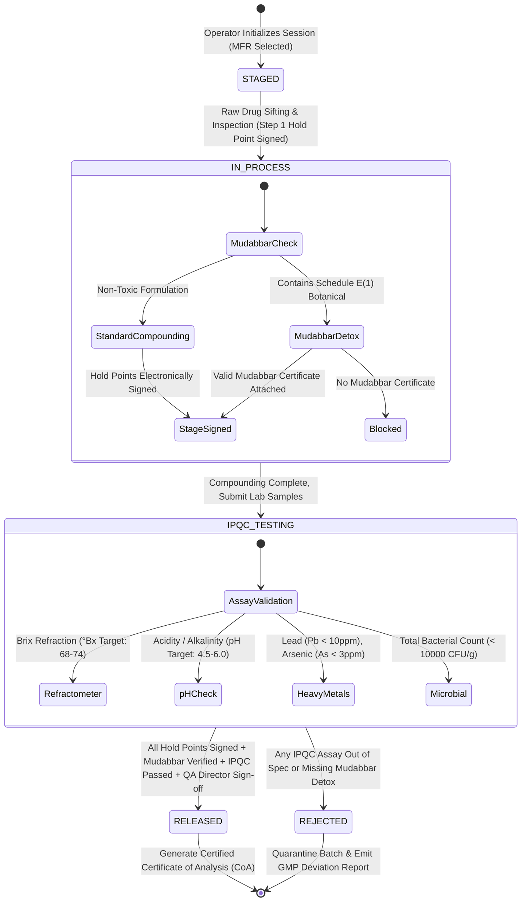

---

## 7. Multi-Tier AI Provider Chained Fallback Cascade

```mermaid
sequenceDiagram
    autonumber
    actor Clinician as Treating Clinician
    participant Copilot as Hakeem Sahab Copilot Engine
    participant Router as ChainedFallbackRouter
    participant Claude as Tier 1: Anthropic Claude 3.5 Sonnet
    participant GPT as Tier 2: OpenAI GPT-4o
    participant vLLM as Tier 3: Local Self-Hosted vLLM
    participant Local as Tier 4: Deterministic Unani Knowledge Engine

    Clinician->>Copilot: Clinical Inquiry / Diagnostic Consultation
    Copilot->>Router: generate(system_prompt, user_prompt)
    
    critical Primary Cloud Provider
        Router->>Claude: POST /v1/messages (system, user)
        Claude--xRouter: 503 Service Unavailable / Rate Limit Exceeded
    end
    
    Note over Router: Catch Exception; Log Degradation:<br/>"AI Provider 'Claude' failed. Failing over."
    
    critical Secondary Cloud Provider
        Router->>GPT: POST /v1/chat/completions
        GPT--xRouter: Connection Timeout / Network Partition
    end
    
    Note over Router: Catch Exception; Log Degradation:<br/>"AI Provider 'GPT-4o' failed. Failing over."
    
    critical Local Air-Gapped Cluster
        Router->>vLLM: POST http://ai-inference:8000/v1/completions
        vLLM-->>Router: HTTP 200 Success (Generated Completion)
    end
    
    Router->>Router: Set last_used_provider_name = "Local vLLM"
    Router-->>Copilot: Return Verified Clinical Recommendation
    Copilot-->>Clinician: Render Verified Response (with Fallback Watermark)
```

---

## 8. 21 CFR Part 11 Cryptographic Merkle Root Anchoring Workflow

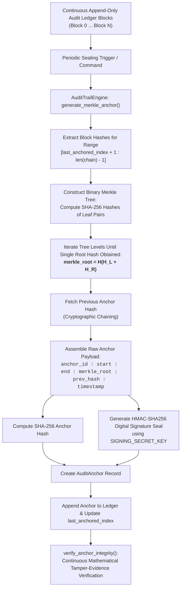

---

## 9. Database Disaster Recovery (PITR) Backup & Verification Drill Flow

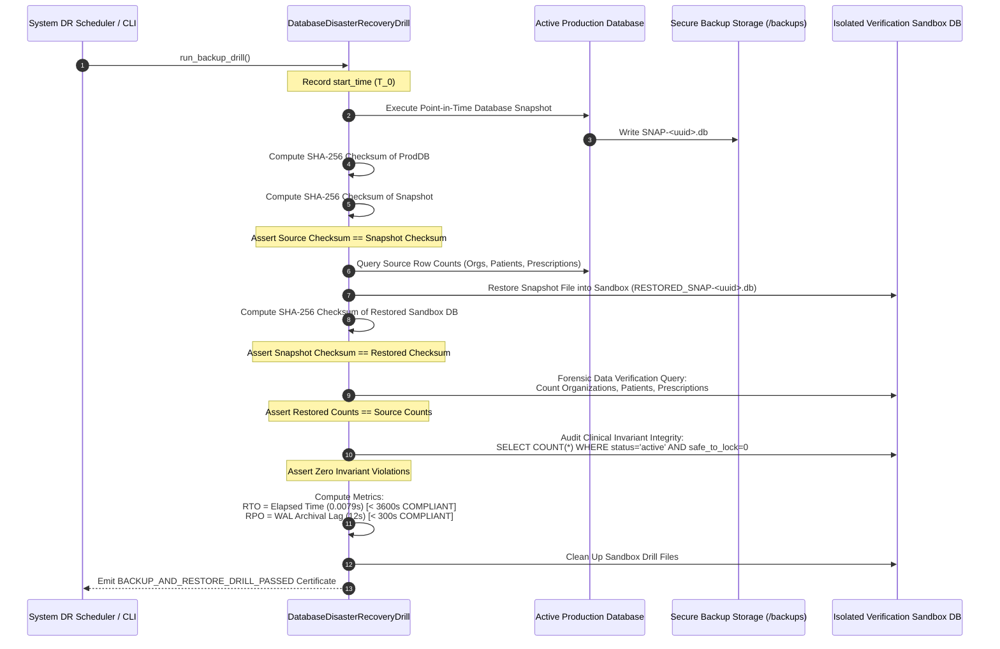

---

## 10. Automated Production Release Rollback Orchestration

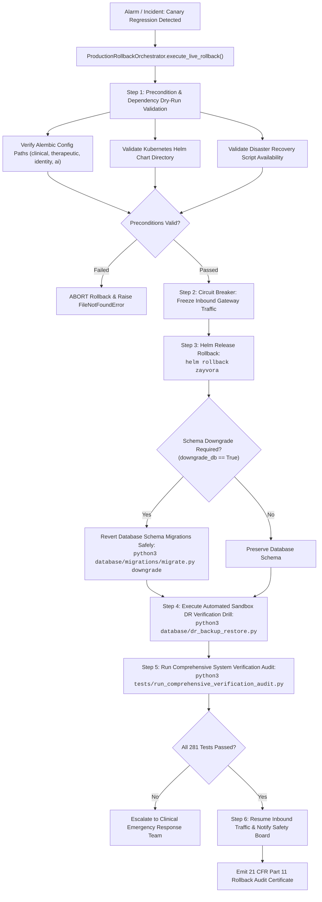

---

## 9. Inbound Payment Gateway Webhook Settlement Flow (AUTO-09)

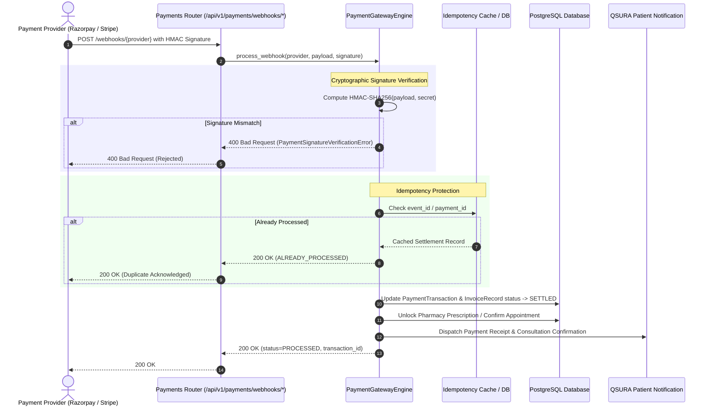

---

## 10. Periodic System Cron Daemon & Scheduled Scanners Architecture (AUTO-01, AUTO-13, AUTO-14)

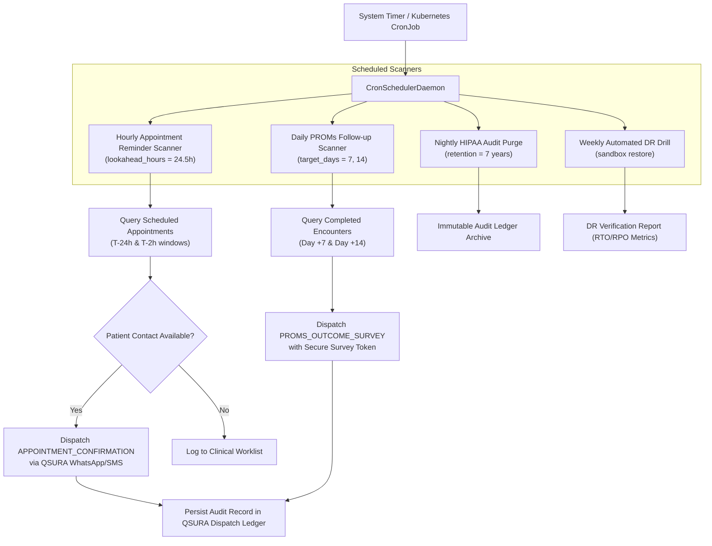

---

## 11. Prescription Delivery Logistics & Courier Tracking Flow (AUTO-15)

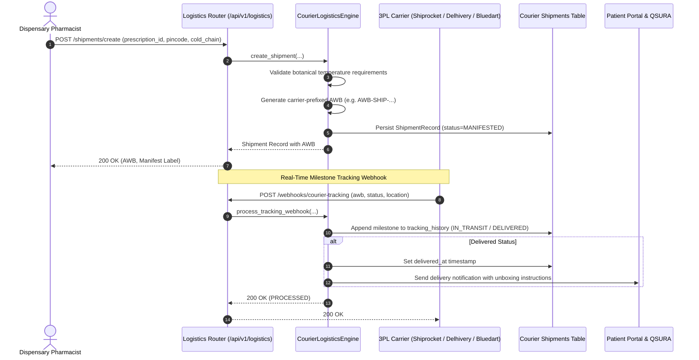
