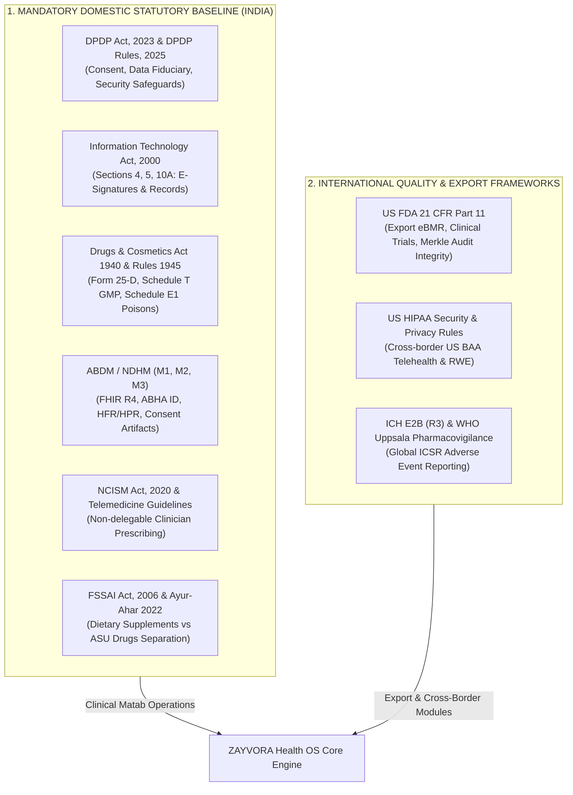

# ZAYVORA Health OS™ — Statutory Compliance & Regulatory Mapping
**Authoritative Architectural Specification v5.0**  
**Classification: Clinical Regulatory, Data Privacy & Legal Compliance Baseline**  
**Date of Ratification: September 19, 2026**

---

## Executive Overview & Doctrinal Boundary

This document defines the formal legal, statutory, and regulatory boundaries of **ZAYVORA Health OS™**. It explicitly resolves ambiguities between Indian statutory mandates, domestic AYUSH clinical/manufacturing licensing, and international quality frameworks (such as US FDA 21 CFR Part 11 and HIPAA).

---

## 1. Domestic Indian Statutory Mandates (Mandatory)

### 1.1 Data Privacy: Digital Personal Data Protection Act, 2023 & DPDP Rules, 2025
All patient health and personal identity processing in ZAYVORA Health OS is governed by the **Digital Personal Data Protection Act, 2023 (Act No. 22 of 2023)** read with the **DPDP Rules, 2025**.

1. **Data Fiduciary Classification**:
   - Healthcare facilities deploying ZAYVORA act as **Data Fiduciaries**.
   - ZAYVORA Cloud / Health OS infrastructure operates as a **Data Processor** acting strictly on behalf of the Data Fiduciary.
2. **Consent Architecture (Section 6)**:
   - Processing of patient health records requires explicit, affirmative, and granular consent.
   - Integration with registered **Consent Managers** enables patients to view, manage, and revoke consent via web and mobile interfaces.
   - Clinical emergency medical treatment falls under Section 7 (Legitimate Uses / Medical Emergency exemptions).
3. **Data Principal Rights (Sections 11–14)**:
   - **Right to Access**: Patients access their personal health records, treatment summaries, and diagnostic reports via the Patient 360 portal.
   - **Right to Correction & Erasure**: Patients may request rectification of non-clinical administrative data. Clinical audit logs remain immutable pursuant to Section 8(7) statutory retention requirements for medical-legal records.
   - **Right of Grievance Redressal**: Facility Data Protection Officer (DPO) contact details are accessible directly within `/website/privacy`.
4. **Reasonable Security Safeguards (Section 8(5))**:
   - Enforced via AES-256 encryption at rest, TLS 1.3 in transit, PBKDF2-HMAC-SHA256 (100,000 iterations) credential hashing, short-TTL session tokens (1 hour), and rate-limited short-TTL (10 minute) identity-hashed OTPs.
   - Non-compliance penalty risk: Up to ₹250 Crore for failing to maintain reasonable security safeguards to prevent data breaches.

---

### 1.2 Electronic Signatures & Records: Information Technology Act, 2000
In the Indian statutory jurisdiction, electronic clinical approval, prescription locking, and electronic medical records derive their legal authority from the **Information Technology Act, 2000**:

1. **Section 4 (Legal Recognition of Electronic Records)**:
   - Satisfies the statutory requirement that medical records, case sheets (Matab registers), and diagnostic histories be in writing or typewritten form by maintaining tamper-evident electronic records.
2. **Section 5 (Legal Recognition of Electronic Signatures)**:
   - Clinician prescription sign-off, regimenal therapy approval, and batch release authorization are authenticated using secure cryptographic electronic signatures.
3. **Section 10A (Validity of Electronic Contracts & Clinical Instructions)**:
   - Recognizes the validity of electronically generated prescription orders and clinical care instructions.
4. **Section 65B (Indian Evidence Act, 1872 / Bharatiya Sakshya Adhiniyam, 2023)**:
   - Electronic prescriptions, audit logs, and diagnostic telemetry are paired with system provenance metadata and SHA-256 Merkle leaf hashes to provide admissible digital evidence in judicial and regulatory inquiries.

---

### 1.3 National Health Interoperability: Ayushman Bharat Digital Mission (ABDM)
ZAYVORA Health OS implements the national digital health architecture established by the **National Health Authority (NHA)**:

1. **ABHA (Ayushman Bharat Health Account)**:
   - Creation, verification, and linking of 14-digit ABHA IDs and ABHA addresses (`@abdm`).
2. **Facility & Healthcare Professional Registries**:
   - **HFR (Health Facility Registry)**: Facility codes (e.g., `FAC-HQ-01`, `FAC-BRANCH-02`) mapped to national HFR identifiers.
   - **HPR (Healthcare Professionals Registry)**: Clinician credentials and registration numbers (e.g., State Council / NCISM registration) validated upon practitioner enrollment.
3. **FHIR R4 Clinical Artefacts**:
   - Clinical documents are serialized and transmitted using standard HL7 FHIR Release 4 profiles:
     - `OPConsultRecord` (Outpatient consultation note)
     - `Prescription` (MedicationRequest with codified UPI/NFUM botanical components)
     - `DischargeSummary` (Inpatient / Tadbeer daycare completion note)
     - `DiagnosticReport` (Lab test reports, Nabz / Qaroorah assessments)
4. **ABDM Milestones**:
   - **M1 (ABHA Creation & Linking)**: Fully implemented.
   - **M2 (Health Information Provider - HIP)**: Push clinical records to ABDM gateway upon patient consent.
   - **M3 (Health Information User - HIU)**: Pull longitudinal health records from federated ABDM ecosystem with active consent artefact.

---

### 1.4 Clinical Governance & Medical Practice: NCISM Act, 2020 & Telemedicine Guidelines
1. **Registered Medical Practitioner (RMP - AYUSH)**:
   - Prescribing authority is restricted strictly to licensed clinicians possessing recognized qualifications under the **National Commission for Indian System of Medicine Act, 2020**.
2. **Non-Delegable Human Clinician Authority**:
   - Artificial intelligence (`Hakeem Sahab™`), automated decision trees, or robotic systems may NEVER prescribe, dispense, or lock clinical treatment plans autonomously.
   - The AI Copilot operates with `safe_to_lock = False` hardcoded across all decision support endpoints. Every treatment requires explicit, physical clinician review, PIN/signature authentication, and confirmation.
3. **Telemedicine Practice Guidelines for Indian System of Medicine (AYUSH)**:
   - Prescriptions issued via telemedicine follow the permissible drug categories:
     - **List O**: Over-the-counter Unani formulations, dietary advice, lifestyle counseling.
     - **List A**: First consultation medicines for specified ailments (classical NFUM compounds).
     - **List B**: Follow-up consultations for chronic disease management.
     - **Prohibited List**: Schedule E(1) poisons without prior in-person clinical examination.

---

### 1.5 Pharmacy & Manufacturing: Drugs & Cosmetics Act, 1940 & Rules, 1945
The pharmaceutical, dispensary, and manufacturing modules are governed by Chapter IV-A of the D&C Act and relevant rules:

1. **Manufacturing License (Form 25-D)**:
   - Applicable to commercial production of Ayurvedic, Siddha, and Unani drugs.
   - Batch Manufacturing Records (eBMR) track raw botanical intake, identity confirmation, master formula compliance, and batch release.
2. **Schedule T Good Manufacturing Practices (GMP)**:
   - Factory premises layout, raw material quarantine, botanical identity testing, moisture limits, volatile oil estimation, microbial contamination limits, and heavy metal testing (Lead, Cadmium, Mercury, Arsenic via ICP-MS).
3. **Schedule E(1) Statutory Poison Control**:
   - Master list of 28 high-risk substances (e.g., *Suranjan Talkh*, *Kuchla*, *Bhang*, *Jamalgota*, *Afeem*, *Shangraf*, *Ras-Kapur*).
   - Strict Mudabbar (detoxification) protocol tracking: No Schedule E(1) substance may be dispensed without a valid, signed Mudabbar Certificate.
   - Mandatory statutory labeling: "Caution: To be taken under medical supervision only" with red box enclosure on packaging.
4. **FSSAI vs. AYUSH Licensing Demarcation**:
   - Classical Unani medicines (codified in First Schedule texts) and AYUSH proprietary medicines are licensed exclusively under **AYUSH Form 25-D**.
   - Proprietary dietary supplements, general herbal beverages, and food items without medicinal therapeutic claims are licensed under **Food Safety and Standards Act, 2006 (FSSAI)** and **Ayur-Ahar Regulations, 2022**.
   - ZAYVORA strictly prevents cross-categorization: medicinal claims are never attached to FSSAI-licensed SKUs.

---

## 2. International Frameworks (Export & Contractual)

### 2.1 US FDA 21 CFR Part 11 (Export & Advanced Integrity Standard)
- **Role in ZAYVORA OS**: 21 CFR Part 11 is an international export quality and data integrity standard. It is not an Indian statute, but is implemented to support export-oriented pharmaceutical manufacturing (eBMR), global decentralized clinical trials (DCT), and international audit readiness.
- **Technical Implementation**:
  - **Audit Trail Chaining (11.10(e))**: Sequential, tamper-evident Merkle tree logging of all record modifications.
  - **Signature Manifestation (11.50)**: Clinician and quality officer signatures record the printed name of the signer, date/time in UTC, and meaning of the signature (e.g., "Review and Approval", "Batch Quarantine Release").
  - **Two-Factor Signature Components (11.200)**: First signature in a session requires identifier + password + MFA; subsequent signatures in the session require PIN confirmation.

### 2.2 US HIPAA Security & Privacy Rules (45 CFR Parts 160 & 164)
- **Role in ZAYVORA OS**: HIPAA is unbundled from mandatory domestic Indian compliance. It applies exclusively when ZAYVORA provides technology services to US Covered Entities or handles US citizen health data under an executed **Business Associate Agreement (BAA)**.
- **Implementation**:
  - Administrative, physical, and technical safeguards.
  - De-identification pipeline adhering to HIPAA Safe Harbor (18 identifier stripping) for international research datasets.

### 2.3 Global Pharmacovigilance: ICH E2B (R3) & WHO Uppsala Monitoring Centre
- Adverse drug reactions (ADRs) and pharmacovigilance reports are formatted per **ICH E2B (R3)** standard XML payloads.
- Enables direct reporting to the **National Pharmacovigilance Coordination Centre (NPvCC - All India Institute of Ayurveda)** and international regulatory agencies.

---

## 3. Statutory Compliance Matrix

| Regulatory Domain | Domestic Statute (India) | International Framework | ZAYVORA OS Enforcement Mechanism |
| :--- | :--- | :--- | :--- |
| **Patient Data Privacy** | Digital Personal Data Protection Act, 2023 & Rules, 2025 | GDPR (EU), HIPAA (US) | Consent manager integration, granular consent revocation, AES-256 storage, DPO registry. |
| **Electronic Records & Signatures** | Information Technology Act, 2000 (Sec 4, 5, 10A) | US FDA 21 CFR Part 11 | PBKDF2 credential signing, HMAC session authentication, Merkle tree tamper-evident audit ledger. |
| **Medical Prescribing Authority** | NCISM Act, 2020; AYUSH Telemedicine Guidelines | AMA / GMC Standards | Strict `safe_to_lock = False` barrier on AI copilot; licensed clinician credentials validated on sign. |
| **Botanical Drug Safety** | Drugs & Cosmetics Act, 1940; Schedule E(1) & Schedule T | WHO Good Agricultural & Collection Practices (GACP) | Automated Mudabbar certification gate, posology limits, real-time FEFO inventory batch release. |
| **Health Interoperability** | Ayushman Bharat Digital Mission (ABDM M1/M2/M3) | HL7 FHIR R4, SNOMED CT | FHIR R4 bundle serialization, ABHA ID linking, ABDM electronic consent artefact validation. |
| **Manufacturing Quality** | D&C Rules Form 25-D, Schedule T GMP | WHO GMP / 21 CFR Part 211 | Electronic Batch Manufacturing Records (eBMR), multi-stage quality sign-offs, heavy metal ICP-MS logs. |
| **Dietary vs Medicinal Products** | FSSAI Act, 2006 vs D&C Act 1940 (Rule 158-B) | US Dietary Supplement Health & Education Act (DSHEA) | Separate catalog partitions for medicinal ASU drugs vs FSSAI Ayur-Ahar supplements. |
