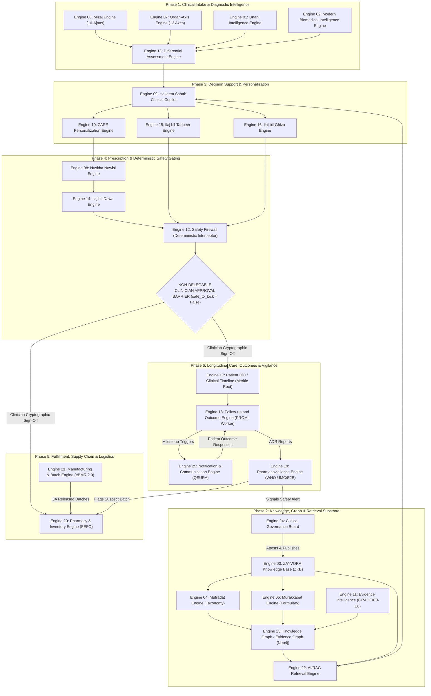
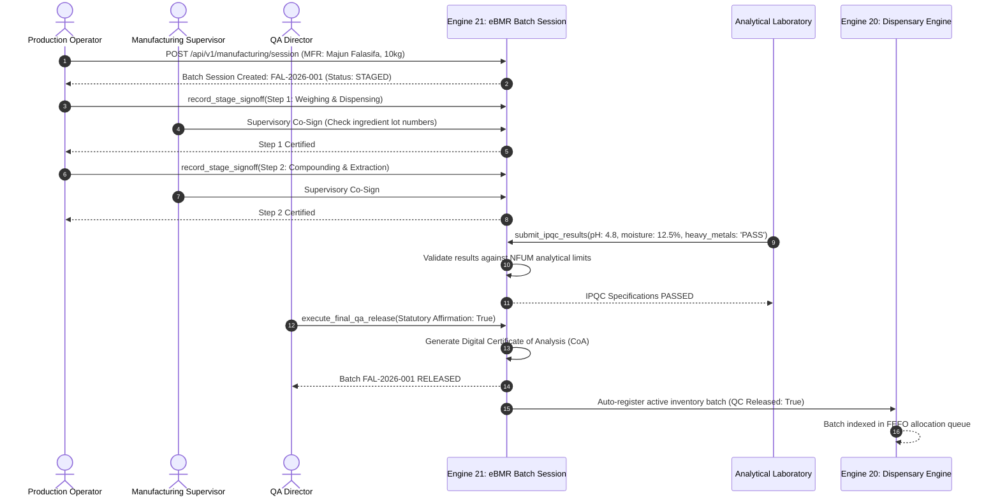

# ZAYVORA HEALTH™ — Engine Dependency Graph & Flow Topology
## Multi-Engine Architectural Interconnects & Sequential Workflows
**Document ID:** ZAYV-AUD-ENG-03  
**Audit Standard:** ISO/IEC 25010 System Architecture Traceability  
**Generated:** 2026-09-12T18:52:00+05:30  
**Scope:** Topological Mapping of all 25 ZAYVORA Engines  

---

## 1. High-Level Engine Ecosystem Architecture

The 25 ZAYVORA engines operate as a tightly federated multi-service mesh. Clinical safety invariants dictate that all diagnostic, personalizing, and retrieval engines operate upstream of the deterministic Safety Firewall and human clinician approval barriers.



---

## 2. End-to-End Clinical Consultation Sequence

The following sequence illustrates the exact runtime inter-engine message lifecycle during a live patient encounter, demonstrating how the deterministic safety barrier intercepts and gates all recommendations.

```mermaid
sequenceDiagram
    autonumber
    actor Clinician as Licensed Clinician (Tabeeb)
    actor Patient as Patient
    participant Gateway as API Gateway / Reverse Proxy
    participant Encounters as Encounters & Notes Router
    participant MizajEng as Engine 06: Mizaj Assessor
    participant AxisEng as Engine 07: Organ-Axis Engine
    participant DiffEng as Engine 13: Differential Engine
    participant Copilot as Engine 09: Hakeem Sahab Copilot
    participant RAG as Engine 22: Hybrid RAG & Knowledge
    participant ZAPE as Engine 10: ZAPE Posology
    participant Nuskha as Engine 08: Nuskha Compiler
    participant Firewall as Engine 12: Safety Firewall
    participant Dispensary as Engine 20: Dispensary FEFO
    participant QSURA as Engine 25: Notification Broker

    Clinician->>Gateway: POST /api/v1/encounters (Start Encounter)
    Gateway->>Encounters: Initialize Clinical Encounter
    Encounters-->>Clinician: Encounter Created (ENC-101)

    Clinician->>Gateway: POST /api/v1/mizaj/assess (10 Ajnas Input)
    Gateway->>MizajEng: calculate_mizaj_assessment(input)
    MizajEng-->>Encounters: Dominant: Haar Yabis, Confidence: 0.85

    Clinician->>Gateway: POST /api/v1/organ-axes/analyze (Symptoms: Joint pain)
    Gateway->>AxisEng: run_complete_organ_axis_analysis(axis='mafasil')
    AxisEng-->>Encounters: Reflex Sympathies: Meda, Kulyah; Biomarker: hsCRP

    Clinician->>Gateway: GET /api/v1/encounters/ENC-101/differential
    Gateway->>DiffEng: match_differential_considerations('Severe big toe joint pain')
    DiffEng-->>Clinician: Ranked: Niqris (Gout, FA25) [Score 8] + 3 Red Flags

    Clinician->>Gateway: POST /api/v1/hakeem/consult
    Gateway->>Copilot: run_hakeem_consultation(EHR context, organ_axis='mafasil')
    Copilot->>RAG: hybrid_search('Suranjan gout', approved_only=True)
    RAG-->>Copilot: Retrieved: Suranjan Talkh, Majun Suranjan
    Copilot->>ZAPE: run_zape_personalization(age, eGFR, Mizaj='Haar Yabis')
    ZAPE-->>Copilot: Scaled Posology: Suranjan Talkh 250mg, Musleh: Katira
    Copilot-->>Clinician: 13 Canonical Sections, safe_to_lock: False

    Clinician->>Gateway: POST /api/v1/nuskha/compile (Accepts & Tweaks Posology)
    Gateway->>Nuskha: compile_nuskha(ingredients=[Suranjan Talkh, Zanjabeel])
    Nuskha->>Firewall: run_safety_firewall(patient_context, ingredients)
    Note over Firewall: Checks Allergies, Pregnancy, Drug-Herb, Schedule E(1) Mudabbar
    Firewall-->>Nuskha: Verdict: SAFE_TO_CONSIDER
    Nuskha-->>Clinician: Compiled Nuskha Draft (Status: DRAFT, safe_to_lock: False)

    Clinician->>Gateway: POST /api/v1/prescriptions/RX-501/lock (Cryptographic JWT Signature)
    Note over Encounters: STATUTORY HUMAN APPROVAL VERIFIED
    Encounters->>Dispensary: POST /api/v1/dispensary/allocate (FEFO Allocation)
    Dispensary->>Dispensary: Check qc_release_status & Mudabbar Certificate
    Dispensary-->>Encounters: Allocated Batch BATCH-OCT (Expiry: 2026-10-15)

    Encounters->>QSURA: POST /api/v1/qsura/send (Digital Rx to Patient)
    QSURA->>Patient: WhatsApp / SMS Delivered (Zero-PHI Masked)
```

---

## 3. Manufacturing to Dispensary Fulfillment Sequence

This sequence models the physical supply chain and Quality Assurance pipeline governed by Engine 21 (eBMR) and Engine 20 (Dispensary).



---

## 4. Longitudinal Outcomes & Pharmacovigilance Feedback Loop

```mermaid
sequenceDiagram
    autonumber
    participant Cron as Scheduled Cron Daemon
    participant PROMs as Engine 18: Follow-up & Outcome Engine
    participant Broker as Engine 25: QSURA Communication Broker
    actor Patient as Patient (WhatsApp)
    participant PV as Engine 19: Pharmacovigilance Engine
    participant Dispensary as Engine 20: Dispensary Engine
    participant GovBoard as Engine 24: Clinical Governance Board

    Cron->>PROMs: Execute Daily Milestone Scan (06:00 UTC)
    PROMs->>PROMs: Identify prescriptions at Day +7 and Day +14
    PROMs->>Broker: Dispatch PROMs Follow-up Survey (Consent Verified)
    Broker->>Patient: Send Interactive WhatsApp Survey (EQ-5D-5L)
    Patient-->>Broker: Inbound Response (Moderate joint relief; reported rash)

    Broker->>PROMs: Ingest Response Payload
    PROMs->>PROMs: Compute Symptom Improvement (+45%)
    PROMs->>PV: Trigger ADR Investigation (Reported Rash with Majun Falasifa)

    PV->>PV: evaluate_who_umc_causality(dechallenge=True, rechallenge=True)
    PV-->>PV: Causality: PROBABLE / CERTAIN
    PV->>PV: Generate ICH E2B(R3) XML Report for PvPI

    PV->>Dispensary: POST /api/v1/dispensary/recall (Class II Batch Recall)
    Dispensary->>Dispensary: Quarantine Batch FAL-2026-001 (qc_release_status='quarantined')

    PV->>GovBoard: POST /api/v1/governance/proposals (Safety Alert: Suspect Batch Quality)
    GovBoard->>GovBoard: Convene Multi-Specialist Quorum Review
```

---

## 5. Architectural Integrity Matrix

| Pipeline Phase | Ingress Engines | Core Processing Engines | Safety / Governance Gates | Egress Engines |
| :--- | :--- | :--- | :--- | :--- |
| **1. Diagnostic Intake** | Client Apps, Patient Portal | Engine 06 (Mizaj), Engine 07 (Axis), Engine 13 (Diff) | No autonomous Dx, Red Flag Interception | Engine 17 (Timeline), Engine 09 (Copilot) |
| **2. Decision Support** | Engine 13, EHR Context | Engine 09 (Hakeem Sahab), Engine 10 (ZAPE) | 13 Canonical Sections, Approved Knowledge Only | Engine 08 (Nuskha Draft) |
| **3. Knowledge Retrieval** | Query, API, Cmd+K | Engine 22 (RAG), Engine 23 (KG), Engine 03 (ZKB) | Minimum Similarity 0.65, Peer-reviewed only | Engine 09, Client Apps |
| **4. Prescribing** | Engine 09, Clinician UI | Engine 08 (Nuskha), Engine 14 (Dawa), Engine 15 (Tadbeer) | Engine 12 (Safety Firewall), safe_to_lock = False | Clinician Sign-off, Engine 20 (Dispensary) |
| **5. Supply Chain** | MFR Recipes, Raw Botanicals | Engine 21 (eBMR), Engine 05 (Murakkabat) | AYUSH Schedule T, Mudabbar Cert, IPQC Assays | Engine 20 (Dispensary FEFO) |
| **6. Longitudinal Vigilance**| Locked Prescriptions, Cron | Engine 18 (PROMs), Engine 19 (PV), Engine 25 (QSURA) | Zero-PHI Masking, DISHA Consent, E2B(R3) Export | Engine 20 (Batch Recall), Engine 24 (Board) |
