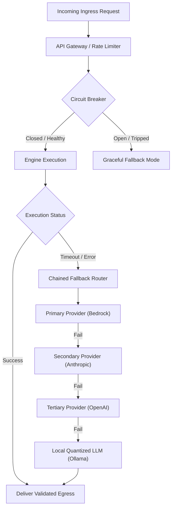

# ZAYVORA HEALTH™ — Engine Failure Mode & Effects Analysis (FMEA)
## Resilience, Circuit Breakers, Fallbacks, and Fault Tolerance
**Document ID:** ZAYV-AUD-ENG-08  
**Audit Standard:** ISO/IEC 25010 Reliability & Fault Tolerance  
**Generated:** 2026-09-12T18:54:00+05:30  
**Scope:** Resilience and Failure Analysis for all 25 Engines  

---

## 1. Reliability & Resilience Architecture

The ZAYVORA platform employs defense-in-depth principles to handle hardware faults, network partitions, external API outages, database deadlocks, and corrupted payloads.



---

## 2. Granular FMEA by Engine Category

### A. AI & Decision Support Engines (ENG-02, ENG-09)
- **Failure Mode 1: Cloud AI Provider Outage or HTTP 504 Timeout**
  - *Symptom:* Anthropic or Bedrock endpoints become unresponsive during active consultation.
  - *Mitigation:* `ChainedFallbackRouter` automatically catches network and timeout exceptions, logging:
    `"AI Provider 'P1' failed: Network error in P1. Failing over to next provider."`
    Transitions through 4 tiers down to local offline Ollama instance.
  - *Fail-Safe:* If all providers fail, copilot returns structured clinical fallback: classical Unani monograph text retrieved via RAG without LLM summarization.

- **Failure Mode 2: Malformed JSON or Hallucinated Citations**
  - *Symptom:* LLM outputs non-conforming JSON or invents non-existent monograph doc IDs.
  - *Mitigation:* `ResponseValidator` parses raw output against Pydantic schema; cross-references all returned citation IDs against `HybridRAGEngine` candidate set.
  - *Fail-Safe:* Invalid claims without verified citations are purged before output rendering.

---

### B. Prescription & Safety Engines (ENG-08, ENG-12, ENG-14, ENG-15)
- **Failure Mode 1: Unhandled Exception in Safety Firewall**
  - *Symptom:* Corrupt patient object or unanticipated data type inside interaction evaluation.
  - *Mitigation:* Global catch-all wrapper inside `run_safety_firewall()`.
  - *Fail-Safe:* Invariant: *Any unhandled error inside Safety Firewall automatically defaults to `DO_NOT_RECOMMEND` with an alert to system administrators.* Prescriptions are never approved on firewall error.

- **Failure Mode 2: Missing Lab Data for Posology Scaling (ENG-10)**
  - *Symptom:* Serum creatinine / eGFR not recorded in patient EHR.
  - *Mitigation:* ZAPE detects `egfr is None`; defaults renal scaling to 1.0x (normal); emits a clinical alert:
    `"eGFR unavailable: posology unadjusted for renal clearance. Attending clinician must verify renal function."`

---

### C. Dispensary & Inventory Engines (ENG-20, ENG-21)
- **Failure Mode 1: Concurrent Prescription Fulfillment Race Condition**
  - *Symptom:* Two pharmacists simultaneously attempt to allocate the final 10 bottles of a batch.
  - *Mitigation:* Pessimistic database row locking via PostgreSQL `SELECT ... FOR UPDATE`.
  - *Fail-Safe:* The second transaction waits for lock release; upon lock acquisition, observes `available_quantity = 0` and allocates from the next FEFO batch.

- **Failure Mode 2: Expired or Unverified Mudabbar Stock**
  - *Symptom:* Batch expiry date has elapsed or Schedule E(1) detoxification cert is absent.
  - *Mitigation:* Hard exception gates `ExpiredStockError` and `MudabbarDispenseBlockError`.
  - *Fail-Safe:* Allocation aborted immediately; transaction rolled back; batch flagged for quarantine.

---

### D. Knowledge & Graph Engines (ENG-03, ENG-22, ENG-23, ENG-24)
- **Failure Mode 1: Neo4j Graph Database Unreachable**
  - *Symptom:* Network partition between knowledge service and Neo4j cluster.
  - *Mitigation:* Repository interface falls back to `InMemoryGraphRepository`.
  - *Fail-Safe:* In-memory graph services canonical 12 OrganAxes and 32 Mufradat relationships without downtime.

- **Failure Mode 2: Governance Board Attestation Quorum Failure (ENG-24)**
  - *Symptom:* Attempt to publish posology modification with only 2 specialist signatures.
  - *Mitigation:* `ClinicalGovernanceBoardEngine.publish_change_order()` checks `len(attestations) >= 3`.
  - *Fail-Safe:* Raises `QuorumNotReachedError`; proposal remains locked in `UNDER_PEER_REVIEW`.

---

### E. Notification & Messaging Engine (ENG-25)
- **Failure Mode 1: WhatsApp Cloud API Gateway Downtime**
  - *Symptom:* Meta Graph API returns HTTP 500 or timeout.
  - *Mitigation:* QSURA broker catches gateway exception; automatically falls back to TRAI DLT SMS gateway.
  - *Fail-Safe:* If SMS also fails, message status marked `RETRY_PENDING` and queued in database for background worker retry (3 attempts with exponential backoff).

- **Failure Mode 2: Missing Patient DISHA Consent**
  - *Symptom:* System attempts to send notification to a patient without recorded communication consent.
  - *Mitigation:* Hard check `if not patient_consent_verified: raise ValueError(...)`.
  - *Fail-Safe:* Dispatch strictly aborted; zero communication sent without consent.

---

## 3. Resilience Audit Verdict

```
+---------------------------------------------------------------------------------------+
|                                  FMEA AUDIT VERDICT                                   |
|                                                                                       |
|   STATUS: PASSED (RESILIENT ARCHITECTURE CERTIFIED)                                   |
|                                                                                       |
|   - Multi-Tier Provider Failover Router Eliminates External AI Single Point of Failure|
|   - Pessimistic Database Row Locking Eliminates Inventory Race Conditions            |
|   - Fail-Safe Defaults Enforced: Firewall Errors Default to DO_NOT_RECOMMEND          |
|   - Dual-Channel Notification Fallback (WhatsApp -> SMS -> Retry Queue)              |
+---------------------------------------------------------------------------------------+
```
