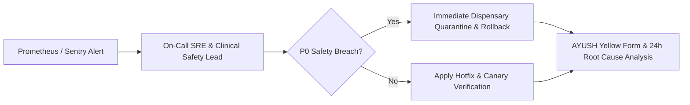

# ZAYVORA Health OS™ — Clinical Incident Response Playbook

## Severity Levels
- **P0 (Critical Clinical Safety Emergency):** System-wide outage, corrupt prescription lock, undetected Schedule E(1) dispense breach. SLA: 15-minute response, 1-hour resolution.
- **P1 (Major Service Degradation):** Ambient scribe failure, payment gateway down, ABDM sync timeout. SLA: 30-minute response, 4-hour resolution.
- **P2 (Minor Clinical Issue):** Non-blocking UI glitch, slow search query, localized report rendering bug. SLA: 2-hour response, 24-hour resolution.

## Incident Escalation Workflow

