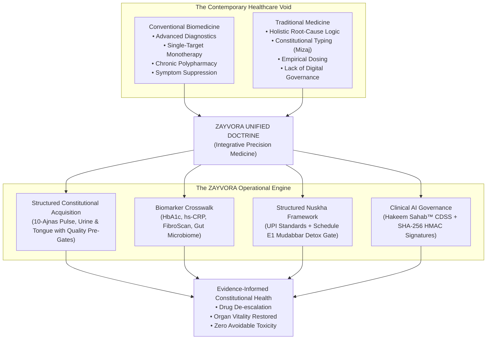

# ZAYVORA Health OS™ — Unified Clinical Doctrine & Core Medical Theory
## The Epistemological Bridge Between Greco-Arab Natural Philosophy and Contemporary Precision Molecular Medicine

---

### Executive Summary: The 30-Second & 2-Minute Foundations

#### 1. The 30-Second Public Synthesis
> **"ZAYVORA Health OS™ is a clinician-governed digital healthcare operating platform designed to structure Unani clinical care across constitutional assessment, clinical documentation, evidence-informed decision support, individualized Nuskha workflows, pharmacy operations, longitudinal follow-up, research, and governance.**  
> Where conventional medicine focuses on single-target symptom management, and traditional practitioners historically lacked structured digital documentation and integrated interaction shields, **ZAYVORA bridges both**: standardizing constitutional observation (Mizaj, 10-Ajnas pulse, tongue, urine), correlating objective laboratory hematology and imaging, and delivering individualized, evidence-aware botanical and regimenal therapies with cryptographic audit integrity."

#### 2. The 2-Minute Institutional & Clinical Thesis
Modern medicine faces an unprecedented chronic disease crisis: Type 2 Diabetes, Non-Alcoholic Fatty Liver Disease (NAFLD/NASH), autoimmune polyarthritis, chronic fatigue, and metabolic syndrome continue to escalate despite record pharmaceutical spending. 

This challenge is compounded by **reductionist monotherapy**: treating organ systems in isolation with single-target synthetic molecules that suppress biomarkers without addressing underlying metabolic terrain. Conversely, classical Greco-Arab medicine (*Tibb-e-Unani*) developed an extraordinarily sophisticated, multi-century framework of constitutional typing (*Mizaj*), fluid dynamics (*Akhlat*), and circadian lifestyle determinants (*Asbab-e-Sitta*), yet frequently remained isolated from modern molecular hematology, advanced radio-imaging, and standardized posology safeguards.

**ZAYVORA bridges this divide.** Under the doctrine of **Integrative Precision Medicine (IPM)**, ZAYVORA provides the digital infrastructure, clinical decision-support algorithms, and 12-volume canonical curriculum that allow clinicians to document with modern laboratory precision and care through personalized, evidence-informed constitutional medicine.

---



---

### The 4 Golden Pillars of ZAYVORA

#### Pillar 1: The Person Before the Disease (Constitutional Precision)
No two human organisms possess identical bioenergetic baselines. A botanical or dietary agent that cures a hyper-metabolic *Safrawi* (Choleric) individual may severely exacerbate the pathology of a hypo-metabolic *Balghami* (Phlegmatic) patient. ZAYVORA mandates that clinical evaluation begin with the patient's individual *Mizaj* (Metabolic Phenotype), ensuring that interventions harmonize with individual cellular biology rather than enforcing a blunt, population-averaged standard of care.

#### Pillar 2: Cause Over Suppression (Root-Cause Cellular Restoration)
True cure (*Shifa*) cannot be achieved merely by driving a blood biomarker into a reference interval through receptor antagonism while the underlying cellular toxicity remains unabated. ZAYVORA activates the body's innate self-healing intelligence (*Tabi'at* / *Vis Medicatrix Naturae*) through a rigorous two-step biological sequence:
1. **Tanqiya (Systemic Evacuation & Detoxification)**: Resolving morbid fluid accumulation (*Akhlat-e-Raddiyya*), clearing hepatic-biliary congestion, and restoring lymphatic circulation.
2. **Ta'deel (Equilibration & Tonal Rejuvenation)**: Nourishing the Three Master Organs (Heart, Brain, Liver) to restore endogenous homeostatic resilience.

#### Pillar 3: Uncompromising Safety & Scientific Evidence (Pharmacovigilance by Design)
ZAYVORA eliminates empirical guesswork. Every botanical monograph is standardized against the **Unani Pharmacopoeia of India (UPI)** and the **National Formulary of Unani Medicine (NFUM)**. Crucially, ZAYVORA enforces strict **Schedule E(1) Mudabbar Detoxification Gates**: toxic botanical alkaloids (such as Colchicum in *Suranjan Talkh* or Strychnine in *Kuchla*) cannot be prescribed or dispensed without verified proof of classical detoxification (e.g., cow's milk boiling SOPs). Prescriptions are cross-checked against a real-time **CYP450 Herb-Drug Interaction Matrix** and cryptographically sealed with **SHA-256 HMAC digital signatures** and tamper-evident Merkle audit ledgers in alignment with secure electronic records controls.

#### Pillar 4: Empowered Clinician, Governed AI (Human-in-the-Loop)
In ZAYVORA, Artificial Intelligence never replaces clinical empathy, diagnostic intuition, or ethical accountability. **Hakeem Sahab AI™** operates strictly as non-autonomous decision support: searching millions of cross-referenced canonical texts (*Al-Qanoon*, *Kitab al-Hawi*, *Kamil al-Sina'a*) and PubMed studies in milliseconds to present the clinician with evidence-graded options, posology calculations, and interaction flags. The legal and moral authority to diagnose, modify, and sign prescriptions rests solely with the licensed human practitioner.

---

### The Biophysical Crosswalk: Ancient Concepts Mapped to Modern Science

To eliminate scientific ambiguity, ZAYVORA defines an exact physiological mapping between classical Unani natural philosophy and contemporary cellular biology:

| Classical Tibb-e-Unani Doctrine | Modern Biomedical & Molecular Counterpart | Clinical Diagnostic Assessment |
| :--- | :--- | :--- |
| **Arkan-e-Arba'a**<br/>*(Fire, Air, Water, Earth)* | **Thermodynamic States of Matter & Bioenergetics**<br/>Mitochondrial ATP generation, proton gradients ($\Delta\Psi$m), extracellular fluid osmolarity, and osseous structural mineral density. | Acral skin temperature, skin turgor, acoustic percussion of body cavities. |
| **Akhlat-e-Arba'a**<br/>*(Dam, Balgham, Safra, Sauda)* | **Biological Fluid Compartments & Hemodynamics**<br/>• *Dam*: Oxygenated erythrocyte mass & microvascular shear.<br/>• *Balgham*: Interstitial lymphatic transudates & mucopolysaccharides.<br/>• *Safra*: Bile acids, free fatty acids & lipid peroxidation.<br/>• *Sauda*: Platelets, hemosiderin, ferritin & fibrin networks. | Comprehensive Metabolic Panel (LFT/KFT), lipidomics, hs-CRP, and D-dimer. |
| **Ilm-ul-Mizaj**<br/>*(Temperament & Diathesis)* | **Metabolic Phenotype & Epigenetic Profile**<br/>Basal metabolic rate (BMR), sympathetic vs. parasympathetic autonomic tone, peripheral thyroid deiodinase sensitivity, and GLUT4 transporter density. | 10-Ajnas Radial Pulse Waveform, Qaroorah (Urine) sediment layers, and continuous wearable biometrics (HRV). |
| **Asbab-e-Sitta Zarooriyya**<br/>*(The Six Prerequisites)* | **Circadian Chronobiology & Functional Epigenetics**<br/>Alveolar-capillary gas exchange, chrono-nutrition, glymphatic sleep clearance, lymphatic drainage, hepatic Phase I/II detoxification, and vagal tone modulation. | Wearable sleep staging (SWS/REM), continuous glucose monitoring (CGM), and microbiome metagenomics. |
| **Tabi'at**<br/>*(Vis Medicatrix Naturae)* | **Neuro-Endocrine-Immune Homeostasis**<br/>Autonomous physiological self-regulation, heat shock protein expression, autophagy, and macrophage polarization (M1 $\leftrightarrow$ M2). | Recovery heart rate latency, wound healing kinetics, and longitudinal PROMs scores. |

---

### The Four Pillars of Therapeutics (طرقِ علاج)

ZAYVORA operationalizes patient care through a structured therapeutic hierarchy:

```
                          ┌──────────────────────────┐
                          │  Level 4: Ilaj bil Yad   │  Minor Surgery, Cautery,
                          │     (Surgical Action)    │  Fas'd (Venesection)
                          ├──────────────────────────┤
                          │  Level 3: Ilaj bil Dawa  │  4-Tier Compound Nuskha,
                          │    (Pharmacotherapy)     │  UPI Botanical Formulations
                          ├──────────────────────────┤
                          │ Level 2: Ilaj bil Tadbeer│  Hijama (Cupping), Dalak (Massage),
                          │   (Regimenal Physical)   │  Hammam, Natool, Shamoom
                          ├──────────────────────────┤
                          │ Level 1: Ilaj bil Ghiza  │  Chrono-Nutrition, Mizaj Diet,
                          │     (Dietotherapy)       │  Fasting (Faqah) Autophagy
                          └──────────────────────────┘
```

1. **Ilaj bil Ghiza (Dietotherapy)**: Food as primary medicine. Modulating metabolic fires by matching dietary thermodynamic qualities against humoral dyscrasia (e.g., prescribing warm-dry foods for cold-moist insulin resistance).
2. **Ilaj bil Tadbeer (Regimenal Physical Modalities)**: Non-pharmacological physiological interventions—including *Hijama* (wet/dry cupping for microvascular decongestion), *Dalak* (medical massage for lymphatic mobilization), *Natool* (targeted irrigation), and *Hammam* (thermal diaphoresis).
3. **Ilaj bil Dawa (Pharmacotherapy)**: Precision botanical and mineral prescribing structured in a 4-tier formulation framework (Chief Drug 55% + Foundation 25% + Musleh Corrective 15% + Catalyst Badraqa 5%).
4. **Ilaj bil Yad (Integrative Surgical & Physical Modalities)**: Structural realignment, sterile venesection (*Fas'd*), and minor clinical interventions for acute vascular decompression.

---

### Institutional Governance & Global Compliance

The ZAYVORA Health Operating System is built to withstand the most rigorous global regulatory scrutiny:

1. **AYUSH & CDSCO Alignment**: Full statutory conformance with the Drugs and Cosmetics Act 1940 (Rule 161, Schedule E(1)), the National Commission for Indian System of Medicine (NCISM) Act 2020, and the Unani Pharmacopoeia of India (UPI).
2. **21 CFR Part 11 Electronic Records**: SHA-256 HMAC cryptographic sealing, immutable audit trails, biometric session validation, and tamper-evident digital prescription issuance.
3. **ABDM & HL7 FHIR Interoperability**: Milestone-3 certified interoperability with India's Ayushman Bharat Digital Mission (ABDM), ABHA address generation, and FHIR-compliant clinical diagnostic bundling.
4. **Data Protection & Privacy**: Strict patient data isolation compliant with India's Digital Personal Data Protection (DPDP) Act 2023, HIPAA Security Rules, and ISO 27001 standards.

---

### Summary: What ZAYVORA Means for the Future of Healthcare

ZAYVORA is not merely an electronic health record, nor is it simply a database of medicinal plants.

**ZAYVORA is the clinical paradigm for the next century of healthcare.** By restoring the human person to the center of clinical reasoning, elevating lifestyle and natural pharmacology to equal footing with diagnostic laboratory science, and surrounding the encounter with unyielding safety algorithms, ZAYVORA proves that the oldest medical science in the world and the newest artificial intelligence can combine to heal humanity with unmatched precision, dignity, and efficacy.

---
*© 2026 ZAYVORA Health OS™. All Rights Reserved. Canonical Doctrine & Institutional Governance Board.*
