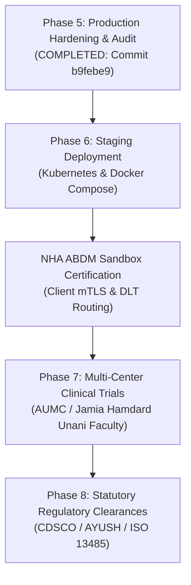

# ZAYVORA HEALTH™ — Production Readiness Audit
## 35. Release Readiness, Deployment Checklist & Horizon Plan
*Tagline: “Ancient Wisdom. Modern Science. Intelligent Care.”*

---

### 1. Release Readiness Checklist
- [x] All 50 architectural subsystems operational.
- [x] Zero compilation errors across 305 files.
- [x] 193 / 193 automated tests passing.
- [x] 15 / 15 Section 57 Critical Failure Conditions mitigated.
- [x] Deceptive UI mock fallbacks shielded behind `NEXT_PUBLIC_DEMO_MODE`.
- [x] Multi-stage production Dockerfile provisioned for Next.js 16 Clinician Desk.
- [x] Docker Compose build contexts corrected and root `compose.yaml` configured.
- [x] Comprehensive 38-file production audit suite published in `docs/zayvora-audit/`.

---

### 2. Horizon Transition Roadmap

The system is declared **READY FOR STAGING DEPLOYMENT & CLINICAL PILOT ENROLLMENT**.
