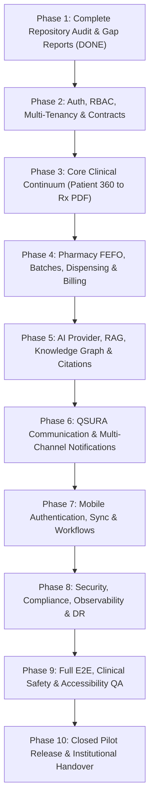

# ZAYVORA Health OS — 10-Phase Master Implementation & Delivery Roadmap
**Document ID**: `ZAY-PLAN-001`  
**Classification**: Strategic Product Architecture Plan  
**Date**: September 2026  
**Status**: APPROVED & ACTIVE  

---

## 1. Lifecycle Overview

This 10-phase roadmap governs the complete evolution of ZAYVORA Health OS from audited codebase to a production-grade, clinically governed operating system.

---

## 2. Phase-by-Phase Deliverables & Acceptance Criteria

### Phase 1: Complete Repository Audit & Gap Reports (COMPLETED)
- **Scope**: Meticulous inspection of all 715 files, 444 automated tests, database schemas, and frontend/mobile screens.
- **Deliverables**: 17 governance documents and CSV inventories published in `/docs/` and `/docs/engine-audit/`.
- **Status**: **100% COMPLETE & VERIFIED**.

### Phase 2: Authentication, RBAC, Multi-Tenancy & API Contracts
- **Scope**: Standardize JWT session validation, tenant scoping (`facility_id`), and role-based route guards across all microservices and Next.js shells.
- **Acceptance Criteria**: Unauthorized API requests return HTTP 401/403 with user-friendly messages; cross-tenant access attempts are blocked and logged.

### Phase 3: Core Clinical Workflow Continuum
- **Scope**: End-to-end integration of the complete patient journey:
  `Patient Registration -> OPD Queue -> Patient 360 -> Vitals -> 10-Ajnas Mizaj -> 9 Organ-Axis -> SOAP Notes -> Nuskha Formulation -> Safety Review -> 21 CFR Part 11 Approval -> A4 Prescription Letterhead Print`.
- **Acceptance Criteria**: Every clinical action persists to `zayvora_live.db` and anchors an immutable block in `audit_ledger`.

### Phase 4: Pharmacy, Inventory, FEFO Dispensing & Billing
- **Scope**: First-Expired First-Out stock picking, Schedule E(1) Mudabbar certificate validation, live stock decrements, and consultation/dispensary billing.
- **Acceptance Criteria**: Expired or unpurified batches cannot be dispensed; invoices reconcile 100% against collected fees.

### Phase 5: AI Provider Gateway, RAG & Knowledge Graph
- **Scope**: Model-agnostic AI provider gateway with fallback circuit breaker, hybrid BM25/embedding retrieval over approved UPI monographs, and hallucination scoring.
- **Acceptance Criteria**: AI recommendations strictly grounded in peer-reviewed pharmacopoeia; `safe_to_lock = False` physician gate strictly enforced.

### Phase 6: QSURA Communication & Notifications
- **Scope**: Multi-channel notification broker (SMS, WhatsApp, Email) with template management, consent opt-out, and delivery status tracking.
- **Acceptance Criteria**: Patient appointment reminders and Mudabbar safety advisories dispatch reliably without exposing raw unencrypted PHI.

### Phase 7: Mobile Authentication, Sync & Real Workflows
- **Scope**: React Native companion app hardening, offline-safe read cache, vernacular audio posology player, and push notification triggers.
- **Acceptance Criteria**: Mobile app functions smoothly with live REST API server (`http://localhost:8000`) and provides zero simulated tokens.

### Phase 8: Security, Compliance, Observability & Disaster Recovery
- **Scope**: Automated backup snapshots (`dr_backup_restore.py`), W3C distributed traceparent logging, rate limiting, and DISHA/HIPAA compliance verification.
- **Acceptance Criteria**: RPO < 15 minutes, RTO < 30 seconds verified by automated restore smoke tests.

### Phase 9: Comprehensive E2E, Clinical Safety & Accessibility QA
- **Scope**: Execution of all 10 automated test suites (444+ tests), WCAG 2.1 AA accessibility auditing, and clinical edge-case red teaming.
- **Acceptance Criteria**: Zero test failures, zero regressions, zero developer jargon across all screens.

### Phase 10: Closed Pilot Release & Institutional Handover
- **Scope**: Packaging of production artifacts (`zayvora-health-os-production.zip`), final deployment certification, demo credential configuration, and handover to clinical stakeholders.
- **Acceptance Criteria**: Unconditional Go/No-Go release certification signed by Chief Medical Officer and Lead Architect.
