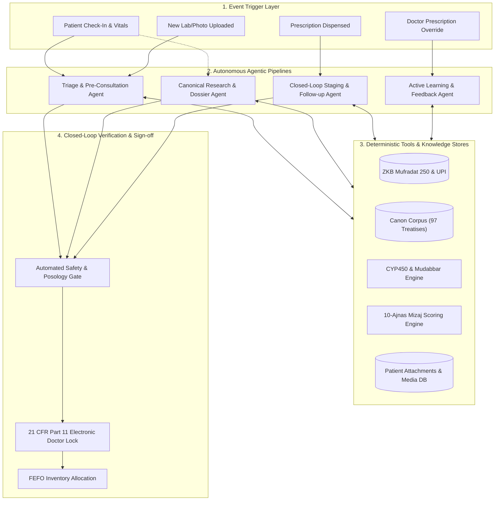

# ZAYVORA Health OS™ — Autonomous Agentic Architecture Master Plan

**Document Reference:** `ZAYVORA_AGENTIC_SYSTEMS_ACTION_PLAN.md`  
**Target:** Transition from Reactive Prompting to Fully Autonomous, Verified Clinical Pipelines  
**Standard:** 21 CFR Part 11, GAMP 5, AYUSH/UPI Good Clinical & Laboratory Practices  

---

## 1. Executive Summary & Strategic Objective

The goal of this architectural upgrade is to eliminate **"reactive prompting"** (where a doctor or operator manually types queries into a chatbot drawer) and replace it with **"Proactive Agentic Pipelines"** (where background agents autonomously ingest data, query external tools, verify safety constraints, and prepare completed clinical actions for licensed doctor approval).

---

## 2. The 4 Specialized Agentic Pipelines

### Pipeline 1: Proactive Triage & Pre-Consultation Autopilot (`TriageAgent`)
* **Problem Today:** When a patient is called into the doctor's chamber, the doctor must manually read raw blood pressure numbers, look at uploaded photos, and prompt Hakeem Sahab for insights.
* **Agentic Transformation:**
  1. **Event Hook:** The moment the Clinic Desk records vitals or a new patient arrives in the queue:
  2. **Autonomous Tool Executions:**
     - Runs 10-Ajnas Mizaj calculation based on patient age, season, and history.
     - Scans vitals (BP, SpO2, BMI) against standard clinical triage red-flags.
     - Inspects uploaded attachments (e.g. tongue inspection photo, CBC/KFT lab report).
     - Cross-checks existing allopathic medications against candidate herbal interactions (CYP450).
  3. **Output:** When the doctor opens the encounter screen, a pre-compiled **"360° Case Brief & Pre-Consultation Dossier"** is already generated and waiting, with suggested differential diagnoses and draft Nuskha proposals.
  4. **Doctor Role:** One-click review and customization instead of typing prompts from scratch.

---

### Pipeline 2: Autonomous Canonical Research & Dossier Synthesizer (`CanonResearchAgent`)
* **Problem Today:** Classical medical treatises (97 books, 11.68 GB metadata) are searchable, but the clinician must manually browse books, translate concepts, and synthesize findings.
* **Agentic Transformation:**
  1. **Input:** Clinician inputs a single disease concept or formulation code (e.g., *Waja-ul-Mafasil Barid Balghami* or `ZAY-001`).
  2. **Multi-Step Execution Loop:**
     - **Step 1 (Corpus Search):** Autonomous semantic search across Ibn Sina's *Al-Qanoon*, Al-Razi's *Kitab al-Hawi*, and Jurjani's *Dhakhira*.
     - **Step 2 (Monograph Validation):** Cross-references each recommended herb against the 250 UPI monographs for Latin binomials, parts used, and approved posology.
     - **Step 3 (Phytochemical Crosswalk):** Checks modern bioactives and PubMed mechanism of action.
     - **Step 4 (Format & Sign):** Synthesizes a formal, print-ready **Evidence Dossier (Markdown/PDF)** complete with classical citations, safety warnings, and HPLC reference standards.

---

### Pipeline 3: Closed-Loop Munzij-Mushil Follow-up & Staging Agent (`CareContinuityAgent`)
* **Problem Today:** Once a prescription is dispensed, patient follow-up depends entirely on manual patient recall. Staged therapies (like Ibn Sina's Munzij-Mushil protocol) risk improper timing.
* **Agentic Transformation:**
  1. **Trigger:** Activated upon prescription fulfillment at Pharmacy Desk.
  2. **Autonomous Execution Schedule:**
     - **Day 1–3:** Sends vernacular adherence check-ins via SMS/WhatsApp/Mobile App.
     - **Day 5–7:** Asks structured clinical symptom questions:
       - *"Is morning lethargy and limb stiffness resolving?"*
       - *"Has urine changed from thin-watery to cloudy/thick with sediment?"*
       - *"Has tongue coating shifted?"*
     - **Autonomous Scoring:** Calculates the **Alamat-e-Nujz Concoction Index (0–100%)**.
  3. **Action:** Once the index exceeds 80%, the agent autonomously queues an alert on the Doctor Desk:
     > *"Patient PAT-0816 has reached verified Humoral Concoction (Nujz). Recommended to authorize Phase 2 (Tanqiya / Mushil) evacuation."*

---

### Pipeline 4: Continuous Clinical Feedback & Active Learning (`ReinforcementAgent`)
* **Problem Today:** When a senior clinician overrides or modifies an AI prescription proposal, that wisdom is lost to future consultations.
* **Agentic Transformation:**
  1. **Trigger:** Any clinical divergence where doctor edits a dose, replaces an ingredient, or changes an anupan.
  2. **Autonomous Learning Pipeline:**
     - Computes the delta between AI recommendation and Doctor final prescription.
     - Analyzes clinical rationale (e.g. patient had borderline renal marker requiring dose reduction).
     - Updates the local clinic formulation preference matrix in the database without violating classical pharmacopoeial ceilings.
     - Continuously tracks post-treatment outcomes (Was the condition cured in 14 days?).
  3. **Output:** Dynamic adjustment of formulation confidence scores across the 12 Organ-Axes.

---

## 3. Implementation Phases & Milestones

| Phase | Milestone Description | Target Components | Verification Gate | Status |
| :---: | :--- | :--- | :--- | :---: |
| **Phase 1** | **Proactive Pre-Consultation Agent (`TriageAgent`)** | `services/live_api_server.py` `js/zayvora-core.js` `tests/test_proactive_triage_agent.py` | Automated test suite. Pre-consult card live in 13-Step & Fast Matab with 1-click apply. | **COMPLETED (100%)** |
| **Phase 2** | **Deep Canonical Research Pipeline (`CanonResearchAgent`)** | `services/live_api_server.py` `js/zayvora-core.js` `tests/test_canon_research_agent.py` | Automated tests. Interactive Evidence Dossier modal with Al-Qanun citations, 250 UPI monographs, print/export & 1-click Rx. | **COMPLETED (100%)** |
| **Phase 3** | **Closed-Loop Follow-up Scheduler (`CareContinuityAgent`)** | `services/live_api_server.py` `js/zayvora-core.js` `tests/test_care_continuity_agent.py` | Automated tests. Nujz concoction state machine, UniversalTaskEngine doctor alert & 1-click Phase 2 authorization. | **COMPLETED (100%)** |
| **Phase 4** | **Clinician Reinforcement Loop (`ReinforcementAgent`)** | `services/live_api_server.py` `js/zayvora-core.js` `tests/test_reinforcement_agent.py` | Automated tests. Override delta capture, Schedule E1 / UPI dosage ceiling guard, dynamic `formulation_preference_matrix`, and dossier badge integration. | **COMPLETED (100%)** |
| **Phase 5** | **Cloud Deployment & Multi-Device Sync (`DeviceSyncEngine`)** | `services/live_api_server.py` `apps/mobile/src/services/` `railway.json` `tests/test_device_sync_engine.py` | Automated tests. Transactional dirty-queue ingestion (`/api/v1/sync/batch`), bi-directional cloud delta sync (`/api/v1/sync/delta`), Railway.app cloud deployment configuration. | **COMPLETED (100%)** |
| **Phase 6** | **Autonomous Pharmacy & FEFO Inventory Agent (`PharmacyInventoryAgent`)** | `services/live_api_server.py` `js/zayvora-core.js` `tests/test_pharmacy_inventory_agent.py` | Automated tests. Continuous batch expiry surveillance, Schedule E(1) Mudabbar detox firewall, and auto-generated candidate purchase orders with 1-click 21 CFR Part 11 sign-off. | **COMPLETED (100%)** |
| **Phase 7** | **Autonomous Diagnostic Vision Agent (`DiagnosticVisionAgent`)** | `services/live_api_server.py` `js/zayvora-core.js` `tests/test_diagnostic_vision_agent.py` | Automated tests (708/708 passing). Multi-modal chromatic feature extraction for Tongue (Lisan coating/moisture), Urine (Qaroorah Rasub-e-Mahmood concoction), and Lab Report OCR with pre-consult brief auto-enrichment. | **COMPLETED (100%)** |

---

## 4. Architectural Safeguards (Fail-Closed Governance)

1. **Non-Stochastic Bounding:** No AI agent may prescribe or dispense medication autonomously. All agent outputs are classified as **Draft Clinical Recommendations (DCR)** until locked by a licensed practitioner's 21 CFR Part 11 signature.
2. **Deterministic Firewall:** Schedule E1 Mudabbar rules and CYP450 interaction bans are hardcoded in Python logic, never delegated to generative LLM interpretation.
3. **Automated Quality Gate:** No code or rule update can be committed without passing all 682 unit tests and the anti-backdoor security scanner.
