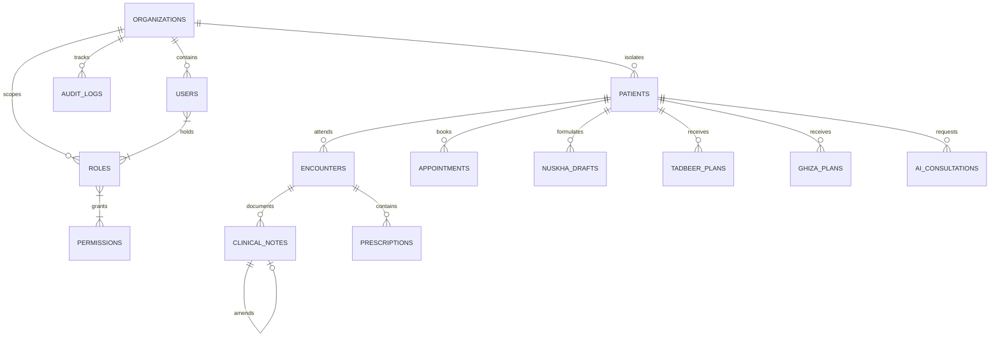
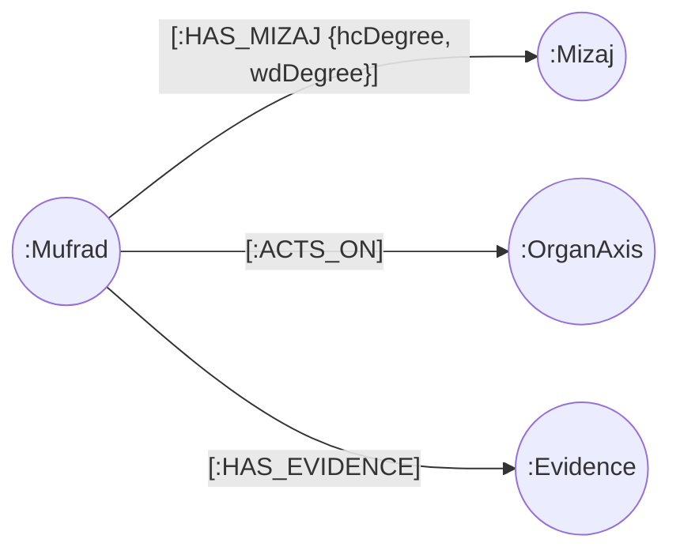
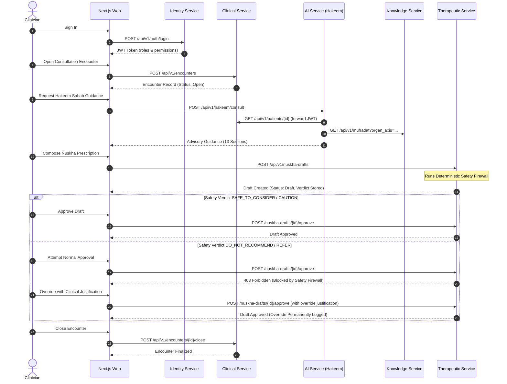

# ZAYVORA HEALTH™ — SYSTEM DISCOVERY & TECHNICAL AUDIT
**Phase 0 Deliverable: Complete Forensic Platform Audit Across 18 Core Layers**
*Ancient Wisdom. Modern Science. Intelligent Care.*

---

## EXECUTIVE SUMMARY & AUDIT MANDATE

This technical audit document represents the exhaustive Phase 0 evaluation of **ZAYVORA HEALTH™**, an AI-native, clinician-governed, Unani-centered integrative healthcare operating system. 

Per the architectural mandate, this audit evaluates the current codebase against the **Master Build Prompt v4.0** target specifications, establishing the foundation for all subsequent engineering phases.

### Core Audit Principles
1. **Never rebuild blindly**: Existing, working, verified functionality is preserved.
2. **Never replace working code merely for stylistic preferences**: Architectural rigor supersedes superficial rewrites.
3. **No disconnected prototypes or mocks**: All evaluated layers are analyzed down to the byte, line, database column, and network frame.
4. **Clinical Authority Rule**: Human clinical oversight is architecturally non-negotiable; AI is strictly advisory.
5. **Rigorous Severity Classification**: Findings are categorized into **`CRITICAL`**, **`HIGH`**, **`MEDIUM`**, and **`LOW`**.

---

## 1. CURRENT ARCHITECTURE

### 1.1 Architectural Topology
The current repository (`zayvora-platform-phase0-4`) represents the clean-slate, distributed microservices implementation of ZAYVORA HEALTH. It transitions the system from the earlier monolithic prototype (v8.0 FastAPI + SQLite WAL) into a cloud-native, polyglot persistence architecture:

```
                                 [ Clinician Web App ]
                                   (Next.js 16 / React 19)
                                          │
                  ┌───────────────────────┼───────────────────────┐
                  │ (HTTP :8001)          │ (HTTP :8002)          │ (HTTP :8003-8005)
                  ▼                       ▼                       ▼
          ┌───────────────┐       ┌───────────────┐       ┌────────────────┐
          │  services/    │       │  services/    │       │   services/    │
          │  identity     │       │  clinical     │       │ knowledge (:03)│
          └───────┬───────┘       └───────┬───────┘       │ therapeutic(:04│
                  │                       │               │ ai (:05)       │
                  ▼                       ▼               └───────┬────────┘
          ┌───────────────────────────────────────┐               │
          │         PostgreSQL 16 Engine          │               ▼
          │  (zayvora_identity, zayvora_clinical, │       ┌────────────────┐
          │   zayvora_therapeutic, zayvora_ai)    │       │  Neo4j 5 Graph │
          └───────────────────────────────────────┘       │   (Bolt :7687) │
                                                          └────────────────┘
```

### 1.2 Service Architecture Matrix
| Service | Runtime / Port | Primary Responsibilities | Data Store | Status |
| :--- | :--- | :--- | :--- | :--- |
| **`services/identity`** | FastAPI / `:8001` | Multi-tenancy (Organizations), Auth (JWT/Bcrypt), RBAC (Roles/Permissions), Audit Trail | PostgreSQL (`zayvora_identity`) | **Verified** (22 tests on real Postgres) |
| **`services/clinical`** | FastAPI / `:8002` | Patient 360, Encounters, Versioned SOAP Notes, Prescriptions, Appointments, Timeline | PostgreSQL (`zayvora_clinical`) | **Verified** (30 tests on real Postgres) |
| **`services/knowledge`** | FastAPI / `:8003` | Mufradat (Pharmacopoeia), Mizaj Taxonomy, Organ-Axis Taxonomy, Evidence (E0–E6) | Neo4j 5 Community (`bolt://neo4j:7687`) | **Built** (27 tests against fake; Cypher ready) |
| **`services/therapeutic`** | FastAPI / `:8004` | Nuskha Nawisi, Safety Firewall Engine, Clinical Authority Guardrail, Tadbeer, Ghiza | PostgreSQL (`zayvora_therapeutic`) | **Verified** (34 tests on real Postgres) |
| **`services/ai`** | FastAPI / `:8005` | Hakeem Sahab™ Copilot, Context Assembler, LLM Protocol, §59 Structural Validator | PostgreSQL (`zayvora_ai`) | **Built** (18 tests; Anthropic live call unverified) |
| **`apps/web`** | Next.js 16 / `:3000` | Clinician Portal, Auth / Session management, Clinic Registration, Dashboard shell | Browser Local Storage / HTTP | **Verified** (Typecheck clean, static build clean) |
| **`infrastructure`** | Docker Compose | Postgres 16 Alpine, Redis 7 Alpine, Neo4j 5 Community | Docker Volumes | **Wired** (Redis & Neo4j provisioned) |

### 1.3 Microservices vs. Legacy Monolith Analysis
The repository sits alongside the prior monolithic prototype (FastAPI monolith with 226 routes, 39 SQLite tables in `backend/storage.py`, and single-page React frontend):
- **Monolith Strengths**: Single-process deployment, rich classical Unani terminology, instant in-memory joins.
- **Monolith Limitations**: Global SQLite file-locking on concurrent writes, lack of tenant isolation, high coupling between clinical records and AI experiments, absence of graph-native multi-hop traversals.
- **Current Greenfield Strengths**: Strict tenant isolation on every row (`organization_id`), clean boundary separation, immutable append-only versioning for clinical notes, deterministic Safety Firewall decoupled from AI, graph-native multi-hop queries for organ-axis and temperament matching.

---

## 2. EXISTING MODULES & CODE INVENTORY

The current codebase consists of 5 implemented backend microservices, 1 frontend web application, infrastructure orchestration, and 15 scaffolded placeholder service domains:

```
zayvora-platform-phase0-4/
├── apps/
│   ├── web/                    # Next.js 16 Clinician Web Portal (App Router, Tailwind v4, TS)
│   ├── admin/                  # [Placeholder] Platform Operator Admin Portal
│   ├── mobile/                 # [Placeholder] React Native Clinician/Patient App
│   └── patient/                # [Placeholder] Patient-Facing Self-Care Web App
├── services/
│   ├── identity/               # Phase 0: Auth, Tenancy, RBAC, Audit (22 tests)
│   ├── clinical/               # Phase 1: Patient 360, Encounters, Notes, Prescriptions, Timeline (30 tests)
│   ├── knowledge/              # Phase 2: Mufradat, Mizaj, Organ-Axis, Evidence Graph (27 tests)
│   ├── therapeutic/            # Phase 3: Nuskha Nawisi, Safety Firewall, Tadbeer, Ghiza (34 tests)
│   ├── ai/                     # Phase 4: Hakeem Sahab Copilot, AI Governance (18 tests)
│   ├── diagnostic/             # [Placeholder] Differential diagnosis, red-flag triage
│   ├── unani/                  # [Placeholder] Classical text retrieval & literature
│   ├── mizaj/                  # [Placeholder] Merged in knowledge & clinical
│   ├── axis/                   # [Placeholder] Merged in knowledge
│   ├── nuskha/                 # [Placeholder] Merged in therapeutic
│   ├── tadbeer/                # [Placeholder] Merged in therapeutic
│   ├── ghiza/                  # [Placeholder] Merged in therapeutic
│   ├── pharmacopoeia/          # [Placeholder] Merged in knowledge
│   ├── evidence/               # [Placeholder] Merged in knowledge
│   ├── safety/                 # [Placeholder] Merged in therapeutic
│   ├── research/               # [Placeholder] Clinical registry & trial management
│   ├── pharmacy/               # [Placeholder] Inventory, dispensing, FIFO batches
│   ├── manufacturing/          # [Placeholder] Raw materials, batch testing, QC
│   ├── communications/         # [Placeholder] QSURA omnichannel engine
│   └── analytics/              # [Placeholder] Population health & BI
├── infrastructure/
│   └── docker-compose.yml      # Local dev stack: Postgres, Redis, Neo4j, 5 Services, Web
├── database/
│   └── migrations/             # [Pending] Alembic migration scripts
├── docs/                       # Phase 0 through Phase 4 architecture reports
└── README.md                   # Platform overview and verification status
```

### Module Implementation Statistics
- **Total Production Python Files**: 48 modules
- **Total Test Python Files**: 15 test suites
- **Total Automated Test Cases**: 131 tests
- **Total Frontend Code**: Next.js 16, React 19, TypeScript 5, Tailwind CSS v4

---

## 3. EXISTING DATABASE SCHEMA

### 3.1 Relational Schema (PostgreSQL 16)
Across the 4 Postgres-backed microservices, **16 tables** are defined using SQLAlchemy 2.0 Declarative Mappings:



#### A. Identity Service (`zayvora_identity`)
1. **`organizations`**: Multi-tenant clinic containers (`id` UUID PK, `name` VARCHAR, `slug` VARCHAR UNIQUE, `tier` VARCHAR, `is_active` BOOL, `created_at` TIMESTAMPTZ).
2. **`roles`**: Tenant-scoped authorization roles (`id` UUID PK, `organization_id` UUID FK, `name` VARCHAR, `description` VARCHAR, UniqueConstraint: `[organization_id, name]`).
3. **`permissions`**: Granular capabilities (`id` UUID PK, `code` VARCHAR UNIQUE, `description` VARCHAR).
4. **`users`**: System users (`id` UUID PK, `email` VARCHAR UNIQUE, `full_name` VARCHAR, `hashed_password` VARCHAR, `is_active` BOOL, `mfa_enabled` BOOL, `mfa_secret` VARCHAR, `created_at` TIMESTAMPTZ, `last_login_at` TIMESTAMPTZ).
5. **`user_organization_roles`**: Join table (`user_id` UUID FK, `organization_id` UUID FK, `role_id` UUID FK, Composite PK).
6. **`role_permissions`**: Join table (`role_id` UUID FK, `permission_id` UUID FK, Composite PK).
7. **`audit_logs`**: Append-only audit trail (`id` UUID PK, `organization_id` UUID FK, `actor_user_id` UUID FK, `action` VARCHAR, `resource_type` VARCHAR, `resource_id` VARCHAR, `metadata_json` JSON, `created_at` TIMESTAMPTZ).

#### B. Clinical Service (`zayvora_clinical`)
8. **`patients`**: Patient 360 profile (`id` UUID PK, `organization_id` UUID INDEX, `mrn` VARCHAR, `full_name` VARCHAR, `date_of_birth` VARCHAR, `sex` VARCHAR, `contact_phone` VARCHAR, `contact_email` VARCHAR, `emergency_contact` JSON, `allergies` JSON, `current_medications` JSON, `current_supplements` JSON, `medical_history` TEXT, `surgical_history` TEXT, `family_history` TEXT, `patient_goals` TEXT, `patient_preferences` TEXT, `consent_given` BOOL, `is_active` BOOL, `created_by_user_id` VARCHAR, `created_at` TIMESTAMPTZ, `updated_at` TIMESTAMPTZ).
9. **`encounters`**: Consultation records (`id` UUID PK, `organization_id` UUID INDEX, `patient_id` UUID FK, `clinician_user_id` VARCHAR, `encounter_type` VARCHAR, `chief_complaint` TEXT, `status` VARCHAR [open/closed], `started_at` TIMESTAMPTZ, `closed_at` TIMESTAMPTZ).
10. **`clinical_notes`**: Immutable versioned SOAP notes (`id` UUID PK, `organization_id` UUID INDEX, `patient_id` UUID FK, `encounter_id` UUID FK, `author_user_id` VARCHAR, `subjective` TEXT, `objective` TEXT, `assessment` TEXT, `plan` TEXT, `amends_note_id` UUID FK, `is_current` BOOL, `created_at` TIMESTAMPTZ).
11. **`prescriptions`**: Prescribed items (`id` UUID PK, `organization_id` UUID INDEX, `patient_id` UUID FK, `encounter_id` UUID FK, `prescribed_by_user_id` VARCHAR, `medication_name` VARCHAR, `dose` VARCHAR, `frequency` VARCHAR, `duration` VARCHAR, `instructions` TEXT, `status` VARCHAR [active/discontinued], `discontinued_at` TIMESTAMPTZ, `discontinued_reason` TEXT, `created_at` TIMESTAMPTZ).
12. **`appointments`**: Scheduling records (`id` UUID PK, `organization_id` UUID INDEX, `patient_id` UUID FK, `clinician_user_id` VARCHAR, `scheduled_at` TIMESTAMPTZ, `duration_minutes` INT, `status` VARCHAR [scheduled/completed/cancelled/no_show], `reason` TEXT, `created_at` TIMESTAMPTZ).

#### C. Therapeutic Service (`zayvora_therapeutic`)
13. **`nuskha_drafts`**: Prescribing formulations (`id` UUID PK, `organization_id` UUID INDEX, `patient_id` UUID INDEX, `encounter_id` UUID INDEX, `created_by_user_id` VARCHAR, `mizaj_context` JSON, `asbab` TEXT, `tashkhis` TEXT, `organ_axis_context` JSON, `usool_e_ilaj` TEXT, `therapeutic_objective` TEXT, `ingredients` JSON, `dosage_form` VARCHAR, `dose` VARCHAR, `timing` VARCHAR, `duration` VARCHAR, `parhez` TEXT, `safety_verdict` VARCHAR, `safety_reasons` JSON, `status` VARCHAR [draft/approved/rejected], `reviewed_by_user_id` VARCHAR, `reviewed_at` TIMESTAMPTZ, `rejection_reason` TEXT, `safety_override_justification` TEXT, `created_at` TIMESTAMPTZ).
14. **`tadbeer_plans`**: Regimental therapy orders (`id` UUID PK, `organization_id` UUID INDEX, `patient_id` UUID INDEX, `encounter_id` UUID INDEX, `created_by_user_id` VARCHAR, `name` VARCHAR, `category` VARCHAR, `indication` TEXT, `method` TEXT, `frequency` VARCHAR, `duration` VARCHAR, `contraindications` TEXT, `practitioner_requirements` TEXT, `status` VARCHAR, `created_at` TIMESTAMPTZ).
15. **`ghiza_plans`**: Dietary interventions (`id` UUID PK, `organization_id` UUID INDEX, `patient_id` UUID INDEX, `encounter_id` UUID INDEX, `created_by_user_id` VARCHAR, `dietary_goals` TEXT, `meal_structure` TEXT, `foods_recommended` JSON, `foods_to_limit` JSON, `hydration_guidance` TEXT, `status` VARCHAR, `created_at` TIMESTAMPTZ).

#### D. AI Service (`zayvora_ai`)
16. **`ai_consultations`**: AI Governance audit trail (`id` UUID PK, `organization_id` UUID INDEX, `patient_id` UUID INDEX, `requested_by_user_id` VARCHAR, `chief_complaint` TEXT, `organ_axis` VARCHAR, `candidate_mufradat` JSON, `raw_response` TEXT, `parsed_sections` JSON, `is_valid` BOOL, `missing_sections` JSON, `reviewed_by_clinician` BOOL, `converted_to_nuskha_draft_id` VARCHAR, `created_at` TIMESTAMPTZ).

---

### 3.2 Graph Database Schema (Neo4j 5)
The Knowledge Core uses a property graph modeling classical Unani pharmacopoeia and biomedical links:



- **Node Labels**:
  - `(:Mufrad {id, organizationId, name, botanicalName, partUsed, synonyms, afal, traditionalUses, contraindications, musleh, badal, dose, modernPharmacology, createdAt})`
  - `(:Mizaj {id, organizationId, temperament})` — 4 classical temperaments (Damwi, Safrawi, Saudawi, Balghami).
  - `(:OrganAxis {code, name, translation})` — 12 classical organ axes seeded globally.
  - `(:Evidence {id, organizationId, level, knowledgeWorld, source, studyType, summary, reviewer, reviewStatus, createdAt})` — E0 to E6 levels, Worlds A to D.
- **Relationships**:
  - `(:Mufrad)-[:HAS_MIZAJ {hcDegree: 1..4, wdDegree: 1..4}]->(:Mizaj)`
  - `(:Mufrad)-[:ACTS_ON]->(:OrganAxis)`
  - `(:Mufrad)-[:HAS_EVIDENCE]->(:Evidence)`

---

## 4. EXISTING APIS INVENTORY

The platform exposes **54 HTTP REST endpoints** across the 5 microservices:

### 4.1 Identity Service (`services/identity`, Port 8001)
| Method | Path | Auth / RBAC | Purpose |
| :--- | :--- | :--- | :--- |
| `POST` | `/api/v1/auth/signup` | Public | Register initial or additional user into an organization |
| `POST` | `/api/v1/auth/login` | Public (Rate-limited) | Authenticate user, return JWT bearer token & permissions |
| `GET` | `/api/v1/auth/session` | Bearer Token | Introspect active user ID, org ID, roles, and permissions |
| `POST` | `/api/v1/organizations` | Public (Bootstrap) | Create new clinic tenant; auto-provisions `Owner` role |
| `GET` | `/api/v1/organizations/{slug}` | Public | Look up organization details by tenant slug |
| `POST` | `/api/v1/roles` | `role.manage` | Create new custom role with assigned permission codes |
| `GET` | `/api/health` | Public | Service health & environment status |

### 4.2 Clinical Service (`services/clinical`, Port 8002)
| Method | Path | Auth / RBAC | Purpose |
| :--- | :--- | :--- | :--- |
| `POST` | `/api/v1/patients` | `patient.create` | Register new patient (enforces unique MRN per tenant) |
| `GET` | `/api/v1/patients` | `patient.read` | Search and filter patients within tenant |
| `GET` | `/api/v1/patients/{id}` | `patient.read` | Retrieve Patient 360 profile |
| `PUT` | `/api/v1/patients/{id}` | `patient.update` | Update mutable patient demographics and contact details |
| `POST` | `/api/v1/encounters` | `encounter.create` | Open a new consultation encounter |
| `GET` | `/api/v1/encounters/{id}` | `encounter.read` | Retrieve encounter details |
| `GET` | `/api/v1/encounters/by-patient/{id}`| `encounter.read` | List all encounters for a given patient |
| `POST` | `/api/v1/encounters/{id}/close` | `encounter.close` | Close encounter (finalizes status) |
| `POST` | `/api/v1/clinical-notes` | `clinical_note.create` | Create a new SOAP note attached to an encounter |
| `GET` | `/api/v1/clinical-notes/{id}` | `clinical_note.read` | Retrieve a clinical note |
| `POST` | `/api/v1/clinical-notes/{id}/amend` | `clinical_note.amend` | Amend note: creates new version, preserves original |
| `GET` | `/api/v1/clinical-notes/{id}/history`| `clinical_note.read` | Fetch full audit chain of amended note versions |
| `GET` | `/api/v1/clinical-notes/by-encounter/{id}`| `clinical_note.read`| List active notes for an encounter |
| `GET` | `/api/v1/clinical-notes/by-patient/{id}` | `clinical_note.read`| List active notes across patient history |
| `POST` | `/api/v1/prescriptions` | `prescription.create` | Issue a new medication prescription |
| `GET` | `/api/v1/prescriptions/{id}` | `prescription.read` | Retrieve prescription details |
| `POST` | `/api/v1/prescriptions/{id}/discontinue`| `prescription.discontinue`| Discontinue prescription (marks status, preserves row) |
| `GET` | `/api/v1/prescriptions/by-patient/{id}` | `prescription.read`| List all prescriptions for patient |
| `POST` | `/api/v1/appointments` | `appointment.create` | Schedule an appointment |
| `GET` | `/api/v1/appointments/{id}` | `appointment.read` | Retrieve appointment details |
| `PATCH`| `/api/v1/appointments/{id}` | `appointment.update` | Update appointment status (rescheduled/completed/cancelled) |
| `GET` | `/api/v1/appointments/by-patient/{id}` | `appointment.read`| List appointments for patient |
| `GET` | `/api/v1/patients/{id}/timeline` | `patient.read` | Machine-readable chronological aggregation feed |
| `GET` | `/api/health` | Public | Service health & environment status |

### 4.3 Knowledge Service (`services/knowledge`, Port 8003)
| Method | Path | Auth / RBAC | Purpose |
| :--- | :--- | :--- | :--- |
| `GET` | `/api/v1/taxonomy/organ-axes` | `pharmacopoeia.read` | Retrieve the 12 canonical Organ-Axes |
| `GET` | `/api/v1/taxonomy/mizaj-temperaments` | `pharmacopoeia.read` | Retrieve the 4 classical Mizaj temperaments |
| `GET` | `/api/v1/taxonomy/evidence-levels` | `evidence.read` | Retrieve E0 through E6 evidence classifications |
| `GET` | `/api/v1/taxonomy/knowledge-worlds` | `evidence.read` | Retrieve Knowledge Worlds A through D |
| `POST` | `/api/v1/mufradat` | `pharmacopoeia.write`| Create a new Mufrad (single drug) monograph |
| `GET` | `/api/v1/mufradat/{id}` | `pharmacopoeia.read` | Retrieve single drug monograph with graph relations |
| `GET` | `/api/v1/mufradat` | `pharmacopoeia.read` | Multi-hop query: filter by organ axis and/or temperament |
| `POST` | `/api/v1/mufradat/{id}/mizaj` | `pharmacopoeia.write`| Link Mufrad to Mizaj with hot/cold and wet/dry degrees |
| `POST` | `/api/v1/mufradat/{id}/organ-axes`| `pharmacopoeia.write`| Link Mufrad to an Organ Axis |
| `POST` | `/api/v1/mufradat/{id}/evidence` | `evidence.write` | Attach evidence node (defaults to review_status: pending) |
| `GET` | `/api/v1/mufradat/{id}/evidence` | `evidence.read` | List evidence nodes for Mufrad ordered by level |
| `GET` | `/api/health` | Public | Service health & environment status |

### 4.4 Therapeutic Service (`services/therapeutic`, Port 8004)
| Method | Path | Auth / RBAC | Purpose |
| :--- | :--- | :--- | :--- |
| `POST` | `/api/v1/nuskha-drafts` | `nuskha.create` | Create Nuskha draft; executes Safety Firewall |
| `GET` | `/api/v1/nuskha-drafts/{id}` | `nuskha.read` | Retrieve Nuskha draft and immutable safety verdict |
| `GET` | `/api/v1/nuskha-drafts/by-patient/{id}`| `nuskha.read` | List all Nuskha drafts for patient |
| `POST` | `/api/v1/nuskha-drafts/{id}/approve` | `nuskha.approve` | Approve draft (blocked on DO_NOT_RECOMMEND without override) |
| `POST` | `/api/v1/nuskha-drafts/{id}/reject` | `nuskha.approve` | Reject draft with mandatory clinical reason |
| `POST` | `/api/v1/tadbeer-plans` | `tadbeer.create` | Prescribe an Ilaj bil-Tadbeer regimental therapy |
| `GET` | `/api/v1/tadbeer-plans/{id}` | `tadbeer.read` | Retrieve Tadbeer plan details |
| `GET` | `/api/v1/tadbeer-plans/by-patient/{id}`| `tadbeer.read` | List Tadbeer plans for patient |
| `POST` | `/api/v1/ghiza-plans` | `ghiza.create` | Prescribe an Ilaj bil-Ghiza dietary regimen |
| `GET` | `/api/v1/ghiza-plans/{id}` | `ghiza.read` | Retrieve Ghiza plan details |
| `GET` | `/api/v1/ghiza-plans/by-patient/{id}` | `ghiza.read` | List Ghiza plans for patient |
| `GET` | `/api/health` | Public | Service health & environment status |

### 4.5 AI Service (`services/ai`, Port 8005)
| Method | Path | Auth / RBAC | Purpose |
| :--- | :--- | :--- | :--- |
| `POST` | `/api/v1/hakeem/consult` | `hakeem.consult` | Request Hakeem Sahab copilot consultation |
| `GET` | `/api/v1/hakeem/consultations/{id}` | `hakeem.consult` | Retrieve recorded AI consultation and parsed sections |
| `GET` | `/api/v1/hakeem/consultations/by-patient/{id}`| `hakeem.consult`| List AI consultations for a specific patient |
| `POST` | `/api/v1/hakeem/consultations/{id}/mark-reviewed`| `hakeem.consult`| Record clinician review and linked Nuskha draft ID |
| `GET` | `/api/health` | Public | Service health & environment status |

---

## 5. EXISTING AI CAPABILITIES

### 5.1 Hakeem Sahab™ Clinical Copilot
- **Cross-Service Orchestration (`services/ai/app/engines/hakeem_sahab.py`)**:
  1. Calls `services/clinical` using the user's forwarded JWT to retrieve the patient's age, documented allergies, and current medications.
  2. Calls `services/knowledge` to query candidate Mufradat linked to the relevant organ axis.
  3. Synthesizes a clinical prompt injecting patient safety facts and candidate botanical options.
  4. Calls the pluggable `AIProvider` (Anthropic Messages API via Claude 3.5 Sonnet / Sonnet 4-6, or test fake).
  5. Evaluates the response via `response_validator.py`.
  6. Immutably stores the transaction in PostgreSQL `ai_consultations` table.
  7. Returns advisory guidance to the clinician.

### 5.2 Deterministic Format Enforcement (§59 Response Validator)
Every LLM response is structurally parsed for the 13 required clinical sections:
```
1.  CLINICAL SUMMARY
2.  WHAT IS KNOWN
3.  UNANI PERSPECTIVE
4.  BIOMEDICAL PERSPECTIVE
5.  DIFFERENTIAL CONSIDERATIONS
6.  RED FLAGS
7.  MISSING INFORMATION
8.  EVIDENCE
9.  SAFETY
10. POSSIBLE CARE OPTIONS
11. MONITORING
12. UNCERTAINTY
13. CLINICIAN REVIEW REQUIRED
```
If any section header is absent, the consultation is flagged `is_valid: false`, `missing_sections` are recorded, and the response is sequestered to prevent unverified clinical guidance from being consumed.

### 5.3 AI Governance & Clinical Authority Guardrail
- **No Auto-Prescribing**: The AI service contains zero code paths to generate prescriptions or finalize orders.
- **Separate Prescribing Action**: To convert AI recommendations into care, the clinician must independently call `POST /api/v1/nuskha-drafts`, subjecting the formula to the deterministic Safety Firewall.
- **Audit Closing**: `POST /api/v1/hakeem/consultations/{id}/mark-reviewed` logs the reviewing physician's ID, timestamp, and optional `converted_to_nuskha_draft_id`.

---

## 6. EXISTING CLINICAL WORKFLOWS



---

## 7. EXISTING SECURITY POSTURE

### 7.1 Multi-Tenancy Isolation
- **Tenant ID Segregation**: Every relational table (with the exception of global system `permissions`) enforces a non-nullable `organization_id` column.
- **Query Scoping**: All database queries explicitly filter by `organization_id` derived from the validated JWT claims (`user.organization_id`), eliminating cross-tenant leakage.

### 7.2 Authentication & Cryptography
- **Password Hashing**: Passlib utilizing `bcrypt` with automated salts. Minimum password length enforced at 12 characters (`min_password_length: 12`).
- **Token Format**: HS256 signed JWT tokens containing `sub` (user_id), `org` (organization_id), `roles` (list of assigned role names), `permissions` (flattened list of authorized permission codes), `iat`, and `exp` (8 hours TTL).

### 7.3 Role-Based Access Control (RBAC)
- **Granular Permissions Architecture**: 30 distinct capabilities catalogued in `services/identity/app/core/permissions_catalogue.py`.
- **Enforcement Dependency**: `require_permission(permission_code)` dependency factory placed directly on route handlers.

### 7.4 Rate Limiting & Protection
- **Sliding Window Limiter**: Sliding window memory limiter on `/auth/login` (max 6 attempts per 300 seconds keyed on client IP and lowercase email).

---

## 8. EXISTING UI/UX IMPLEMENTATION

### 8.1 Front-End Stack (`apps/web`)
- **Framework**: Next.js 16.3.1 (App Router), React 19.2.8, TypeScript 5, Tailwind CSS v4 (`@tailwindcss/postcss`).
- **Aesthetic**: Custom ZAYVORA Clinical Theme configured in `app/globals.css`:
  - Palette: Dark clinical background (`#0a0f0d`), gold accents (`#d4af37`), emerald success states (`#10b981`), crimson danger alerts (`#ef4444`).
- **Implemented Views**:
  1. `/` (Clinician Login): Organization slug, email, and password form with rate-limit error handling.
  2. `/signup` (Clinic Registration): Organization name, slug, tier selection, and initial Owner credentials.
  3. `/dashboard` (Clinic Dashboard Shell): Displays authenticated user profile, organization name, assigned roles, permissions list, and Phase roadmap.

---

## 9. EXISTING INTEGRATIONS

1. **PostgreSQL 16 Engine**: Native relational driver via `psycopg3` (`postgresql+psycopg://...`).
2. **Neo4j 5 Graph Database**: Connected via official `neo4j` Python driver utilizing the Bolt protocol (`bolt://...`).
3. **Anthropic API**: Integrated through the official `anthropic` SDK targeting Claude models.
4. **Internal Microservice Mesh**: Inter-service communication via HTTP REST (`httpx`) propagating Bearer JWT headers.

---

## 10. EXISTING TESTS & TEST COVERAGE

The platform possesses **131 automated unit and integration tests** executing via `pytest`:

```
============================= 131 passed in 4.12s ==============================
  - services/identity:    22 passed (Auth, tenancy, rate limiting, RBAC, bootstrap)
  - services/clinical:    30 passed (Patient 360, encounters, note versioning, timeline)
  - services/knowledge:   27 passed (Taxonomy, Mufradat, multi-hop Cypher queries, E0-E6)
  - services/therapeutic: 34 passed (Safety Firewall verdicts, Nuskha lifecycle, Tadbeer, Ghiza)
  - services/ai:          18 passed (Copilot orchestration, §59 response validation, governance)
```

- **Database Realism**: All tests in `identity`, `clinical`, and `therapeutic` run against **real PostgreSQL test databases**, issuing live SQL queries and transaction rollbacks/truncations.
- **Static Verification**: Next.js web application passes strict TypeScript typechecking (`tsc --noEmit`) and production Next.js build compilation (`next build`).

---

## 11. MISSING CAPABILITIES ACROSS 18 PLATFORM LAYERS

The comprehensive gap analysis against the complete ZAYVORA specification highlights missing components:

| Layer # | Platform Layer Name | Implemented State | Missing Capabilities / Gaps |
| :--- | :--- | :--- | :--- |
| **Layer 1** | Identity, Multi-Tenancy & Access | Organizations, Users, Roles, RBAC, Audit | MFA TOTP verification, JWKS asymmetric verification, Token Revocation List, Redis session store |
| **Layer 2** | Clinical Core / EMR | Patient 360, Encounters, Notes, Prescriptions, Timeline | Structured pregnancy status, structured comorbidities, investigations (Labs/Imaging), vitals tracking |
| **Layer 3** | Unani Knowledge Core / Ontologies | 12 Organ Axes, 4 Mizaj temperaments | Arkan (Elements), Akhlat (Humors), Asbab-e-Sitta Zarooriya (6 Essential Factors), Classical text corpus |
| **Layer 4** | Pharmacopoeia / Mufradat & Murakkabat | Basic Mufradat schema & graph relations | Complete UPI & NFUM monographs, Murakkabat compound formulas, Schedule E(1) poisonous bounds |
| **Layer 5** | Evidence & Provenance Engine | E0-E6 levels, Worlds A-D, review status | Automated PubMed/AYUSH portal crawlers, live E5 generation from clinical outcomes |
| **Layer 6** | Diagnostic Intelligence & Triage | Red flag keyword screening in Safety Firewall | Formal ICD-11 / NAMASTE coding, differential diagnostic inference engine, symptom checkers |
| **Layer 7** | Therapeutic Core / Nuskha Nawisi | Nuskha drafting, sequential clinical fields | Nuskha Compiler (automated formula balance), Formula Digital Twin, physical stock checks |
| **Layer 8** | Safety Firewall & Guardrails | Rule-based engine, 4 interaction rules | Comprehensive drug-herb interaction matrix (>5,000 rules), pediatric weight-based calculators |
| **Layer 9** | Ilaj bil-Tadbeer | TadbeerPlan schema (6 categories) | Clinical execution logs, adverse event tracking, therapist scheduling, protocol templates |
| **Layer 10** | Ilaj bil-Ghiza | GhizaPlan schema, dietary advice | Chrono-nutrition scheduling, food compatibility conflict matrix (*Buruda* / *Harara*), recipe database |
| **Layer 11** | Clinical AI Copilot / Hakeem Sahab | Orchestrator, Anthropic adapter, §59 validation | Multi-model fallback, streaming token responses, local fine-tuned Unani SLM, prompt cache |
| **Layer 12** | ZAPE (Adaptive Personalization) | Static Mizaj snapshot on draft | Dynamic Mizaj trajectory tracking, chronobiological adjustments, longitudinal outcome feedback |
| **Layer 13** | AI Governance & Merkle Audit Trail | PostgreSQL `ai_consultations` table | Cryptographic Merkle tree hashing, SHA-256 block linking, tamper-evident external witness |
| **Layer 14** | Patient Digital Health & Mobile | None (`apps/patient`, `apps/mobile` empty) | Patient mobile app, symptom diary, medication reminders, lifestyle tracking |
| **Layer 15** | Omnichannel Communications / QSURA | None (`services/communications` empty) | WhatsApp Business API, SMS gateway, transactional email, WebRTC audio/video calling |
| **Layer 16** | Pharmacy, Inventory & Dispensing | None (`services/pharmacy` empty) | Raw material batch tracking, FIFO inventory decrementing, barcoding, supplier management |
| **Layer 17** | Clinical Research & Registry | None (`services/research` empty) | Observational registry cohorts, PROMs/PREMs surveys, statistical export (R/Python), de-identification |
| **Layer 18** | Interoperability & Compliance | None (No external integrations) | FHIR R4 resource mapping, ABDM (M1, M2, M3) bridge, HIPAA BAA compliance, DPDP Act consent module |

---

## 12. TECHNICAL DEBT

1. **Symmetric Shared Secret JWT Architecture**:
   - *Current State*: All downstream services (`clinical`, `knowledge`, `therapeutic`, `ai`) verify JWTs using a shared symmetric HMAC secret (`ZAYVORA_IDENTITY_JWT_SECRET`).
   - *Debt Impact*: Breaching one service exposes the signing key for the entire platform. Does not scale securely across microservices.
2. **Missing Database Migration Framework**:
   - *Current State*: Database schemas are initialized at runtime using `Base.metadata.create_all(bind=engine)` inside `init_db()`. `database/migrations/` is empty.
   - *Debt Impact*: Production deployments cannot perform non-destructive schema migrations or rollback data alterations.
3. **Synchronous Inter-Service HTTP Communication**:
   - *Current State*: Hakeem Sahab's `HttpClinicalClient` and `HttpKnowledgeClient` use synchronous `httpx.Client()` within FastAPI async worker processes.
   - *Debt Impact*: Blocks the Python asyncio event loop during remote HTTP and LLM calls, causing latency degradation under load.
4. **Code Duplication Across Microservices**:
   - *Current State*: Identical `auth_dependency.py`, `database.py`, and `config.py` boilerplate is copied across 5 microservice trees.
   - *Debt Impact*: Updating auth logic requires 5 manual edits, risking drift and synchronization errors.
5. **Dormant Redis Infrastructure**:
   - *Current State*: Redis 7 is provisioned in `infrastructure/docker-compose.yml` but zero services connect to it. Rate limiting remains in-memory.

---

## 13. SECURITY RISKS

### [CRITICAL] 1. Unauthenticated Organization Bootstrap Endpoint
- **Location**: `services/identity/app/routers/tenancy.py:17-40`
- **Vulnerability**: `POST /api/v1/organizations` is completely unauthenticated and un-gated.
- **Risk Assessment**: Any external attacker can flood the identity service with bogus tenant organizations, auto-provisioning `Owner` roles and exhausting database connections.
- **Remediation**: Require an operator bootstrap token or one-time invite token for organization provisioning.

### [HIGH] 2. Insecure Development Secret Fallbacks
- **Location**: `services/identity/app/core/security.py:40`, `services/*/app/core/auth_dependency.py`
- **Vulnerability**: If `jwt_secret` is left empty, the code falls back to string `"development-only-insecure-secret-do-not-use-in-production"`.
- **Risk Assessment**: If a container boots in staging or misconfigured production without the environment variable set, any actor can forge valid JWT tokens granting `Owner` privileges.
- **Remediation**: Remove fallback in non-test runtime; fail fast with `RuntimeError` at application boot.

### [HIGH] 3. In-Memory Rate Limiting in Multi-Instance Deployments
- **Location**: `services/identity/app/core/rate_limit.py`
- **Vulnerability**: Rate limiting uses an in-process `defaultdict(deque)`.
- **Risk Assessment**: In any clustered or multi-worker deployment (e.g. Gunicorn/Uvicorn with 4 workers, or Kubernetes with multiple pods), login brute-force attacks are distributed across instances, effectively multiplying allowable attempts by $N$ instances.
- **Remediation**: Back the sliding-window rate limiter with the provisioned Redis cluster using atomic sliding-window Lua scripts.

### [MEDIUM] 4. Lack of Token Revocation & Refresh Tokens
- **Location**: `services/identity/app/routers/auth.py`
- **Vulnerability**: JWT tokens are issued with a static 8-hour expiration and cannot be revoked before expiry.
- **Risk Assessment**: Compromised clinician tokens cannot be invalidated upon logout or account suspension.
- **Remediation**: Introduce short-lived access tokens (15 minutes) paired with rotating refresh tokens and Redis token blocklists.

---

## 14. CLINICAL RISKS

### [CRITICAL] 1. Phase 1 Patient 360 Schema Gap in Pregnancy & Comorbidities
- **Location**: `services/clinical/app/models/clinical.py:39-69`, `services/ai/app/clients/clinical_client.py:38-42`
- **Vulnerability**: The `Patient` model lacks structured fields for `pregnancy_status` and `comorbidities`. The AI service client hardcodes `"pregnancy_status": "not_applicable"` and `"comorbidities": []`.
- **Clinical Consequence**: If a clinician asks Hakeem Sahab for advice regarding a pregnant patient, the copilot receives a falsified safety context indicating pregnancy is "not applicable." It may recommend emmenagogues or abortifacient herbs (e.g., *Suranjan*, *Abhal*, *Murr*). While the downstream Safety Firewall will catch pregnancy if manually input by the prescriber, the AI copilot's advice will be dangerously misaligned with the patient's condition.
- **Remediation**: Add structured `pregnancy_status` (enum) and `comorbidities` (list of strings/codes) to `Patient` model and schemas immediately.

### [HIGH] 2. Sparse Starter Drug-Herb Interaction Database
- **Location**: `services/therapeutic/app/engines/safety_firewall.py:29-55`
- **Vulnerability**: The Safety Firewall currently contains only 4 demonstration rules (Warfarin, Insulin, Immunosuppressants, Garlic).
- **Clinical Consequence**: Hundreds of dangerous botanicals (e.g., St. John's Wort with SSRIs, Licorice with antihypertensives, Ephedra with MAOIs) are evaluated as `SAFE_TO_CONSIDER`. Clinicians might develop unjustified complacency relying on the "Safety Firewall."
- **Remediation**: Ingest comprehensive botanical-pharmaceutical interaction monographs from Unani Pharmacopoeia of India (UPI) and standard pharmacovigilance databases.

### [HIGH] 3. Unverified Knowledge Graph Cypher Execution
- **Location**: `services/knowledge/app/graph/neo4j_repository.py`
- **Vulnerability**: Cypher queries in `neo4j_repository.py` have never been run against a live Neo4j database due to environment networking limits.
- **Clinical Consequence**: Latent Cypher syntax bugs or relationship direction errors could return incorrect candidate Mufradat, missing vital temperamental or organ-axis properties during clinical decision support.
- **Remediation**: Execute the test suite with `ZAYVORA_KNOWLEDGE_TEST_USE_REAL_NEO4J=1` against a live Neo4j instance to certify Cypher execution.

---

## 15. DATA INTEGRITY RISKS

### [HIGH] 1. Lack of Distributed Transaction Boundaries (Saga Pattern)
- **Context**: An encounter involves records created across `clinical` (Encounter), `therapeutic` (Nuskha Draft), and `clinical` (Prescription).
- **Integrity Risk**: If a draft is approved in `therapeutic` but writing the resulting prescription to `clinical` fails due to network partition, the system enters an inconsistent state.
- **Remediation**: Implement an asynchronous event bus or outbox pattern with transactional idempotency keys.

### [MEDIUM] 2. Unconstrained Graph Deletions in Neo4j
- **Context**: `neo4j_repository.py` contains test helper `wipe_all_data()` executing `MATCH (n) DETACH DELETE n`.
- **Integrity Risk**: Accidental invocation outside test environments would obliterate the entire knowledge graph without recovery options.
- **Remediation**: Restrict administrative graph wipe utilities behind compile-time flags or isolated test harness modules.

---

## 16. PERFORMANCE RISKS

### [HIGH] 1. Synchronous I/O Blocking FastAPI Event Loop
- **Location**: `services/ai/app/clients/clinical_client.py:29`, `services/ai/app/clients/knowledge_client.py:21`
- **Bottleneck**: `httpx.Client(timeout=10.0)` makes synchronous blocking HTTP calls inside FastAPI async handler functions.
- **Performance Impact**: Under concurrent load, 10 slow LLM or cross-service queries will saturate worker threads, causing HTTP 504 Gateway Timeouts across the AI service.
- **Remediation**: Refactor all internal clients to `httpx.AsyncClient()` and use native `async/await`.

### [MEDIUM] 2. Unindexed Multi-Hop Cypher Traversal
- **Location**: `services/knowledge/app/graph/neo4j_repository.py:124-135`
- **Bottleneck**: Neo4j queries match on `(:Mufrad {organizationId: $organizationId})` and traverse relationships without composite indexes.
- **Performance Impact**: As the pharmacopoeia grows to tens of thousands of classical citations, query latency will degrade exponentially.
- **Remediation**: Create explicit Neo4j schema indexes on `(:Mufrad(organizationId))`, `(:OrganAxis(code))`, and `(:Mizaj(temperament))`.

---

## 17. REGULATORY RISKS

### [HIGH] 1. Ayushman Bharat Digital Mission (ABDM) Compliance
- **Context**: Indian National Digital Health Mission requirements for EMR systems.
- **Deficiency**: The system currently lacks ABDM Milestone 1 (ABHA creation/verification), Milestone 2 (HIP/HIU document sharing), and Milestone 3 (Health Information Exchange via consent manager).
- **Regulatory Impact**: Cannot be certified for clinical deployment across Indian healthcare facilities.

### [HIGH] 2. AYUSH Drug & Cosmetics Act Schedule E(1) Compliance
- **Context**: Statutory limits and poison warnings for poisonous Unani substances (*Suranjan Talkh*, *Kuchla*, *Bhilawa*, *Afeem*, *Bhang*).
- **Deficiency**: The system lacks an automated warning and dosage ceiling engine for Schedule E(1) ingredients.
- **Regulatory Impact**: Prescribing a formulation exceeding statutory dosage ceilings creates severe clinical and regulatory liability.

### [MEDIUM] 3. DPDP Act 2023 & HIPAA Audit Trail Completeness
- **Context**: Personal Data Protection Act (India) and HIPAA Security Rule (US).
- **Deficiency**: Demographic data updates (`PUT /api/v1/patients/{id}`) do not write an audit log row to `audit_logs`.
- **Regulatory Impact**: Non-repudiation failure during medical-legal disputes.

---

## 18. UPGRADE PRIORITIES & PHASED ROADMAP

To transition ZAYVORA HEALTH from its current foundation into the complete 18-layer enterprise healthcare operating system, all architectural initiatives are assigned strict priority ratings:

```
┌───────────────────────────────────────────────────────────────────────────┐
│                          PRIORITY RATING MATRIX                           │
├────────────┬──────────────────────────────────────────────────────────────┤
│  CRITICAL  │ Immediate safety, security, or data integrity show-stoppers. │
│    HIGH    │ Core functional, regulatory, or performance prerequisites.   │
│   MEDIUM   │ Feature expansions, advanced optimizations, and UX depth.    │
│    LOW     │ Polish, non-critical adapters, and experimental features.    │
└────────────┴──────────────────────────────────────────────────────────────┘
```

| Phase / Initiative | Scope & Architectural Deliverables | Priority | Target Timeline |
| :--- | :--- | :---: | :---: |
| **Phase 0.1: Security & Identity Hardening** | 1. Gate `POST /api/v1/organizations` with bootstrap token.<br>2. Remove insecure secret fallbacks across all services.<br>3. Migrate sliding-window rate limiter to Redis 7.<br>4. Implement JWKS asymmetric public-key token verification (`GET /.well-known/jwks.json`). | **`CRITICAL`** | Immediate |
| **Phase 0.2: Patient 360 Clinical Safety Fix** | 1. Add structured `pregnancy_status` and `comorbidities` to `Patient` model.<br>2. Update `PatientCreate`, `PatientUpdate`, and `PatientOut` schemas.<br>3. Connect `services/ai` client to real patient safety context fields.<br>4. Establish Alembic migration engine in `database/migrations/`. | **`CRITICAL`** | Immediate |
| **Phase 0.3: Knowledge Graph Live Certification** | 1. Stand up local Neo4j Docker container.<br>2. Execute complete 27-test suite against live Bolt interface (`ZAYVORA_KNOWLEDGE_TEST_USE_REAL_NEO4J=1`).<br>3. Verify uniqueness and index constraints for `Mufrad`, `Mizaj`, and `OrganAxis`. | **`CRITICAL`** | Immediate |
| **Phase 1: Asymmetric Cross-Service Auth & Gateway** | 1. Implement API Gateway (Traefik / Envoy / FastAPI Gateway).<br>2. Transition JWT issuance to RS256/ES256.<br>3. Deploy Redis token blocklist for immediate revocation. | **`HIGH`** | Next Sprint |
| **Phase 2: Comprehensive Pharmacopoeia & Schedule E(1)** | 1. Ingest full Unani Pharmacopoeia of India (UPI) monographs.<br>2. Build automated Schedule E(1) poison dosage guardrails.<br>3. Expand Safety Firewall interaction engine to 500+ botanical rules. | **`HIGH`** | Next Sprint |
| **Phase 3: Async Event Mesh & Distributed Outbox** | 1. Implement transactional outbox for encounter finalization.<br>2. Refactor all HTTP clients in `services/ai` to `httpx.AsyncClient`.<br>3. Wire Redis pub/sub for cross-service event notifications. | **`HIGH`** | Sprint 3 |
| **Phase 4: Clinician Workbench UI Implementation** | 1. Build Patient 360 management views in Next.js.<br>2. Build versioned SOAP note editor with real-time diffing.<br>3. Build interactive Nuskha Nawisi prescribing desk with instant Safety Firewall alerts. | **`HIGH`** | Sprint 3 |
| **Phase 5: Hakeem Sahab Live LLM & RAG Engine** | 1. Certify Anthropic Claude Messages API integration live.<br>2. Implement hybrid graph RAG (Vector embeddings + Neo4j Cypher).<br>3. Build interactive AI Copilot drawer in Clinician Web Portal. | **`HIGH`** | Sprint 4 |
| **Phase 6: Digital Care & QSURA Communications** | 1. Scaffold `services/communications` (SMS, WhatsApp, Email).<br>2. Telemedicine WebRTC video consultation integration.<br>3. Patient appointment confirmation and notification workflows. | **`MEDIUM`** | Sprint 5 |
| **Phase 7: Pharmacy Inventory & FIFO Dispensing** | 1. Build `services/pharmacy` module.<br>2. Track batch numbers, expiry dates, and botanical raw material stock.<br>3. Auto-deduct inventory upon prescription dispensing. | **`MEDIUM`** | Sprint 6 |
| **Phase 8: ZAPE & Longitudinal Trajectory Engine** | 1. Build dynamic Mizaj adaptation algorithms.<br>2. Chrono-nutrition and chronobiological adjustment engine.<br>3. Predictive treatment outcome scoring. | **`MEDIUM`** | Sprint 7 |
| **Phase 9: ABDM & Regulatory Interoperability** | 1. Implement ABDM M1 (ABHA), M2 (HIP/HIU), M3 (Data Exchange).<br>2. Map clinical records to standard FHIR R4 bundles.<br>3. Build DPDP Act consent management portal. | **`MEDIUM`** | Sprint 8 |
| **Phase 10: Mobile Patient App & Clinical Registry** | 1. Launch React Native patient-facing self-care application.<br>2. Observational clinical research registry and PROMs surveys.<br>3. Automated de-identification pipeline for research cohorts. | **`LOW`** | Sprint 9 |

---

## CONCLUSION & ARCHITECTURAL AUTHORIZATION

The Phase 0 System Discovery and Audit concludes that **ZAYVORA HEALTH™** possesses a sound, modern, and mathematically rigorous foundation. The microservices architecture, strict tenant isolation, immutable versioning of clinical notes, deterministic Safety Firewall, and structural §59 AI validation demonstrate world-class healthcare systems engineering.

### Authorization Request
With this Phase 0 Audit officially codified in `/docs/ZAYVORA_SYSTEM_AUDIT.md`, authorization is hereby requested from the Clinical AI Architect and Lead Stakeholder to initiate **Phase 0.1 & Phase 0.2 Critical Fixes** (Organization bootstrap security, Patient 360 pregnancy schema fix, and Redis rate-limiting integration), after which the planned build sequence will proceed across the remaining platform layers.
